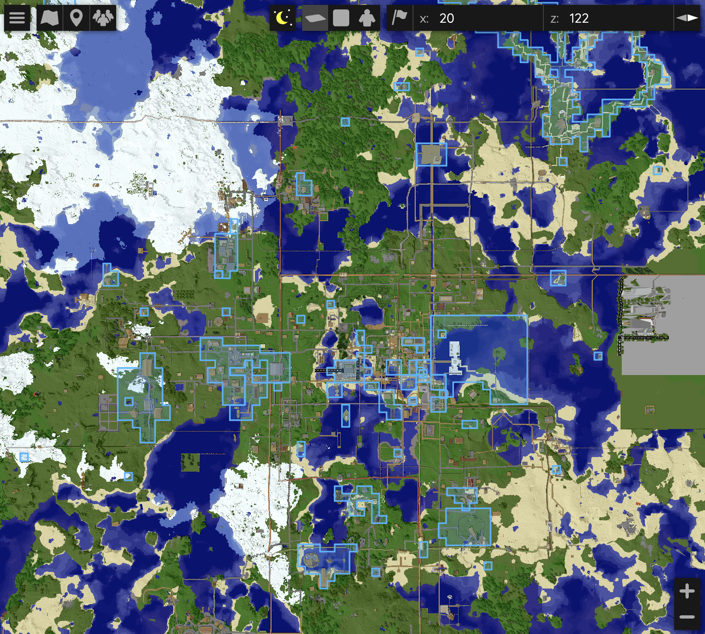
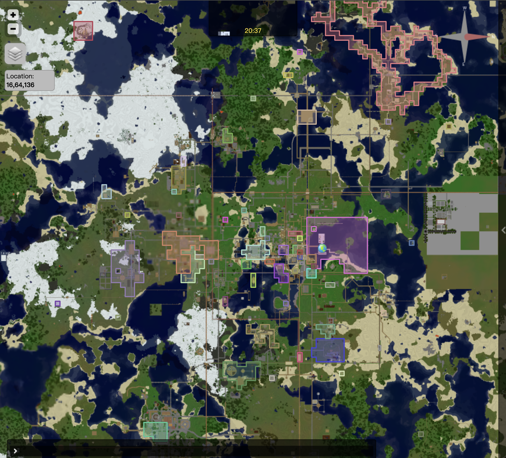
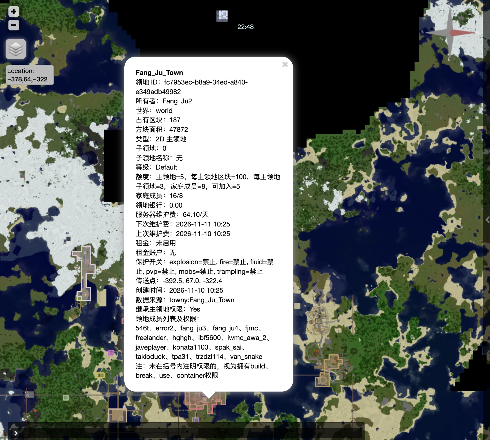

> 本文件是提供给玩家阅读的指南文件，只保留README中的玩家内容，没有包含管理员内容。
> 本文件尽量不提及专业名词，而改用易于理解的方式。
> 本文件提及的数值均为插件默认数值。

<br><p align="center">
  
</p><br>

<h1>BetaLands 领地指南</h1>


## 1 玩家快速流程示例

> 示例中 `AAA` 是主领地，`AAA.bb` 是子领地，`steve` 是玩家名。

| 步骤 | 操作 |
| :--- | :--- |
| 1、创建主领地 | 站在无主区块执行 `/land create AAA`。圈占脚下 16×16 区块，当前位置自动成为传送点。 |
| 2、扩展领地范围 | 站在接壤无主区块执行 `/land claim`。自动圈地使用 `/land claim auto`，再次执行关闭。（自动圈地是走到哪个区块中，自动圈地哪个区块） |
| 3、创建子领地 | （如果有子领地需求）在 `AAA` 内用木锄左键/右键选点，或使用 `/land pos1`、`/land pos2`；然后执行 `/land subcreate bb`。 |
| 4、领地添加玩家 | 站在目标领地内执行 `/land add steve`，自动授予基础权限。（`build、break、use、container、rent`）。目标玩家需在线且执行 `/land accept <领地>` 同意加入领地  |
| 5、踢出或退出 | 领地主在领地内执行 `/land kick steve`；玩家在领地内执行 `/land leave`。 |
| 6、领地传送 | 站在领地内执行 `/land setspawn`；使用 `/land spawn` 或 `/land tp` 传送。 |
| 7、领地银行 | 查看：`/land bank info`；存款：`/land bank deposit 100`；取款：`/land bank withdraw 50` |
| 8、领地租金 | 设置：`/land rent set 5`；预缴：`/land rent deposit 30`；查看：`/land rent info` |
| 9、领地日志 | `/land list`、`/land info`、`/land logs 100` |

## 2 地图标记

地图详情同时显示领地 ID、世界、区块数、面积、类型、子领地数量、等级额度、家庭成员数、银行余额、维护和租金时间、出生点、创建时间、来源以及是否继承父领地权限。

<table>
  <tr>
    <td align="center" width="33%">
      
      <br>
      <sub>在领地变化后 15 秒刷新</sub>
    </td>
    <td align="center" width="33%">
      
      <br>
      <sub>每天凌晨 `01:00` 刷新</sub>
    </td>
    <td align="center" width="33%">
      
      <br>
      <sub><b>地图中领地详情标签</sub>
    </td>
  </tr>
</table>


## 3 玩家指令大全

| 指令 | 说明 | 指令 | 说明 |
| --- | --- | --- | --- |
| `/land` / `/land help` | 指令帮助 | `/land create <名称>` | 创建主领地 |
| `/land claim [主领地]` | 扩展接壤区块 | `/land claim auto [主领地]` | 开关自动圈地 |
| `/land unclaim [主领地]` | 移除当前所在区块，不退费 | `/land info [领地]` | 查看领地信息 |
| `/land list [玩家]` | 查看领地列表 | `/land level` | 查看自己的等级、额度和费率 |
| `/land playtime [玩家]` | 查看在线时间进度 | `/land delete [领地]` | 请求删除领地并显示二次确认 |
| `/land pos1` / `/land pos2` | 设置子领地选点 | `/land subcreate <子领地名>` | 创建 3D 子领地 |
| `/land flags [领地]` | 查看保护开关 | `/land flag <开关> <allow\|deny\|default> [领地]` | 修改保护开关 |
| `/land add <玩家> [领地]` | 添加玩家 | `/land kick <玩家> [领地]` | 踢出玩家 |
| `/land accept <领地>` | 接受领地邀请 | `/land deny <领地>` | 拒绝领地邀请 |
| `/land leave [领地]` | 退出领地 | `/land logs [数量] [领地]` | 查询领地日志 |
| `/land rename <新名称> [领地]` | 修改领地名称 | `/land setowner <在线玩家> [领地]` | 转移主领地主人 |
| `/land perm <玩家> <权限> <allow\|deny> [领地]` | 修改成员权限 | `/land setspawn [领地]` | 设置领地传送点 |
| `/land spawn [领地]` / `/land tp [领地]` | 领地传送 | `/land delete confirm <领地>` | 二次确认并删除领地 |
| `/land bank info [领地]` | 查看领地银行和维护费 | `/land bank deposit <金额> [领地]` | 存入领地银行 |
| `/land bank-all info` | 查看自己全部主领地银行和维护费 | `/land bank-all deposit <金额>` | 按维护费比例批量存入全部主领地 |
| `/land bank withdraw <金额> [领地]` | 从领地银行取款 | `/land rent set <金额> [领地]` | 设置每日租金 |
| `/land rent deposit <金额>` | 向全局租金账户预缴租金 | `/land rent withdraw <金额>` | 从全局租金账户取款 |
| `/land rent info [领地]` | 查看租金和预缴账户 | `/land rent set 0 [领地]` | 关闭每日租金 |

地名统一放在指令末尾。省略地名时优先使用玩家当前站立且有权管理的领地；否则仅当玩家恰好拥有一个主领地时自动选择它。

删除领地分两步：先执行 `/land delete [领地]`，再执行 `/land delete confirm <领地>` 才会删除。删除前主领地银行必须为 `0`：欠费时会提示使用 `/land bank deposit <金额> [领地]` 补缴欠款；有预缴余额时会提示使用 `/land bank withdraw <金额> [领地]` 取走余额。

## 4 领地规则与费用

领地名称只能包含 ASCII 字母、数字、下划线和连字符，不能包含点号；长度由 `limits.min-name-length` 和 `limits.max-name-length` 控制，默认 `2–24`。名称需要全局唯一，软删除后的旧名称可以重新使用。

`/land unclaim` 只能移除主领地当前所在的一个区块。目标区块上有子领地时必须先删除子领地；主领地至少保留一个区块；如果领地传送点所在的区块被移除，传送点会被清空。

3D 子领地的水平范围必须完整位于主领地内。同一水平范围内，子领地不能与其他兄弟子领地重叠；如果两个子领地的 Y 轴范围完全分离，则可以在相同水平坐标上下堆叠。

### 4.1 领地成员权限

成员权限：

| 权限 | 作用 |
| --- | --- |
| `build` | 放置方块、倒桶 |
| `break` | 破坏方块、盛桶 |
| `use` | 门、按钮、拉杆等 |
| `container` | 箱子、熔炉、发射器等 |
| `rent` | 作为该领地成员承担每日租金；默认授予 |
| `pvp` | 对领地内玩家造成伤害 |
| `manage` | 管理成员、权限、旗标和传送点 |
| `all` | 授予全部可授权项 |

规则：
- 加入主领地后，权限作用于主领地及其子领地,加入子领地只获得该子领地权限。
- `/land add` 默认授予 `build、break、use、container、rent`；当 `protection.allow-pvp-by-default: true` 时还会授予 `pvp`。
- 领地主不承担自己领地的租金，这是所有权规则，不依赖 `rent` 权限；其他成员只有拥有 `rent` 且领地租金启用时才会计费。
- 只有实际拥有 `build` 才计入“已加入领地数量”。

### 4.2 领地保护开关

| 开关 | 全局默认 |
| --- | ---: |
| `explosion` | `deny` |
| `fire` | `deny` |
| `fluid` | `deny` |
| `pvp` | `deny` |
| `tp` | `allow` |
| `mobs` | `allow` |
| `trampling` | `allow` |

子领地覆盖值优先，其次继承主领地，最后使用 `config.yml` 全局默认。

`tp` 是公众传送开关，默认 `allow`。关闭后只有领地主、成员和管理员能传送到该领地。领地欠费时，实际成员无法传送；非成员仍可按 `tp=allow` 公众传送到该领地。

### 4.3 领地等级

根据玩家权限不同，等级不同

数值方面：

| 等级 | 权限 | 主领地 | 每主领地最多占有区块 | 每主领地子领地最多数量 | 成员最大数量 | 可加入领地 | 维护收取间隔 |
| --- | --- | ---: | ---: | ---: | ---: | ---: | ---: |
| Default | `betalands.level.default` | 5 | 100 | 3 | 8 | 5 | 3 天 |
| VIP | `betalands.level.vip` | 15 | 200 | 10 | 15 | 30 | 3 天 |
| SVIP | `betalands.level.svip` | 30 | 300 | 50 | 40 | 100 | 3 天 |

价格方面：

| 等级 | 创建领地 | 领地扩展基础价 | 领地扩展按照区块价格增量 | 子领地/方块 | 每区块维护/天 | 每成员维护/天 |
| --- | ---: | ---: | ---: | ---: | ---: | ---: |
| Default | 300.00 | 20.00 | 5.00 | 0.01 | 0.30 | 0.50 |
| VIP | 250.00 | 20.00 | 4.00 | 0.008 | 0.25 | 0.40 |
| SVIP | 200.00 | 20.00 | 3.00 | 0.005 | 0.20 | 0.30 |


## 5 领地维护费

主领地维护费：
服务器规定每区块/每成员的价格 → 主领地主人向领地银行预缴 → 按等级间隔从领地银行扣除 → 扣款累计到 BetaLands 内部服务器维护银行

领地银行余额同时表示维护费预缴余额和欠费：

```yaml
/land bank info [领地]             //查询领地维护费信息
/land bank deposit <金额> [领地]    //向领地银行存钱，作为预缴的领地维护费
/land bank withdraw <金额> [领地]   //从领地银行取钱，取款未扣除的钱
```

领地银行余额为正时是预缴维护费；余额为负时是欠费。存款会先补平欠费，剩余部分继续作为预缴余额。


## 6 领地租金

主领地主人可以为主领地或子领地设置每日租金。租金只向当前领地中拥有 `rent` 权限的成员收缴，不向领地主收缴。将成员的 `rent` 权限设为 `deny` 后，该成员不再参与该领地的租金扣费和提醒。

```yaml
/land rent set <金额> [领地]         //设置领地成员的租金
/land rent set 0 [领地]             //设置租金为0
/land rent deposit <金额>           //向个人全局租金账户存钱，不接受领地参数
/land rent withdraw <金额>          //从个人全局租金账户取钱，不接受领地参数
/land rent info [领地]              //查询领地租金信息
```

每个玩家在全服只有一个租金账户，无论同时租用多少个领地，都从这个账户扣费。

`/land rent deposit <金额>` 只操作玩家的全局租金账户，不接受领地名称。玩家必须至少存在一个有效租金义务或租金欠费；满足后金额会直接进入全局账户，不按领地分配，也不要求在领地内执行。

`/land rent withdraw <金额>` 同样只操作全局租金账户，不接受领地名称。`/land rent set` 和 `/land rent info` 仍可指定领地，因为它们分别修改和查看具体领地的租金配置。

多个领地同时到期时，按每日租金从低到高依次扣除：

```yaml
账户余额充足：所有收取领地租金的会自动扣款
账户余额不足：先支付租金较低的领地，扣到账户为负数时停止
租金账户为负数时，欠费归属于最后扣除的那个领地。之后存款会先补这部分欠费并转给对应领地主，剩余金额继续作为该玩家的预缴租金。
```


## 7 欠费限制

预缴余额低于未来 7 天费用、但仍为非负数时，只发送提醒，不限制操作。

| 项目 | 主领地银行欠费 | 租金账户欠费 |
| --- | --- | --- |
| 禁止的行为 | 禁止扩展领地、创建子领地、添加或踢出成员、通过 `/land perm` 新增 `build` 权限、领地传送，以及领地内的建造、破坏、桶、门、按钮、容器等受保护操作。<br><br>禁止取款；维护费仍会按等级间隔继续扣除，银行负数会持续增加。 | 禁止从租金账户取款。<br><br>禁止在欠费所属领地建造、破坏、桶、门、按钮、容器等受保护操作；禁止传送到欠费领地。<br><br>欠费领地为主领地时，其子领地也受到相同限制。<br><br>后续每日扣费暂停，因负数而跳过的后续领地扣款不会自动补扣。 |
| 允许的行为 | 允许 `/land unclaim` 缩小领地、普通成员主动退出、查询日志和 `/land bank deposit` 补缴；删除领地前必须先补平银行欠费并通过二次确认。<br><br>欠费不会自动删除领地或踢出成员；补缴先清欠费，剩余部分成为预缴维护费。 | 允许 `/land rent deposit` 补缴和 `/land rent info` 查询。<br><br>其他没有欠费的领地不受建造和传送限制。<br><br>租金欠费本身不禁止添加或踢出成员、扩展领地，但这些操作仍可能被主领地银行欠费限制。<br><br>补缴先补给欠费领地主，剩余部分成为全局预缴租金。 |

### 7.1 费用提醒

- 玩家上线后会收到一次费用汇总，包括自己拥有的主领地银行维护费，以及自己作为租金成员需要支付的租金。
- 主领地银行余额低于未来 7 天服务器维护费，或成员的预缴租金低于未来 7 天租金时，对应在线玩家每分钟收到一次提醒。
- 存在未缴欠费时使用欠费提醒；无维护费或未出租的领地不会产生重复警告。

提醒只检查领地银行和租金账户，而不是玩家个人的总余额。


---

<br><br><br>

<p align="center">
  
</p>
