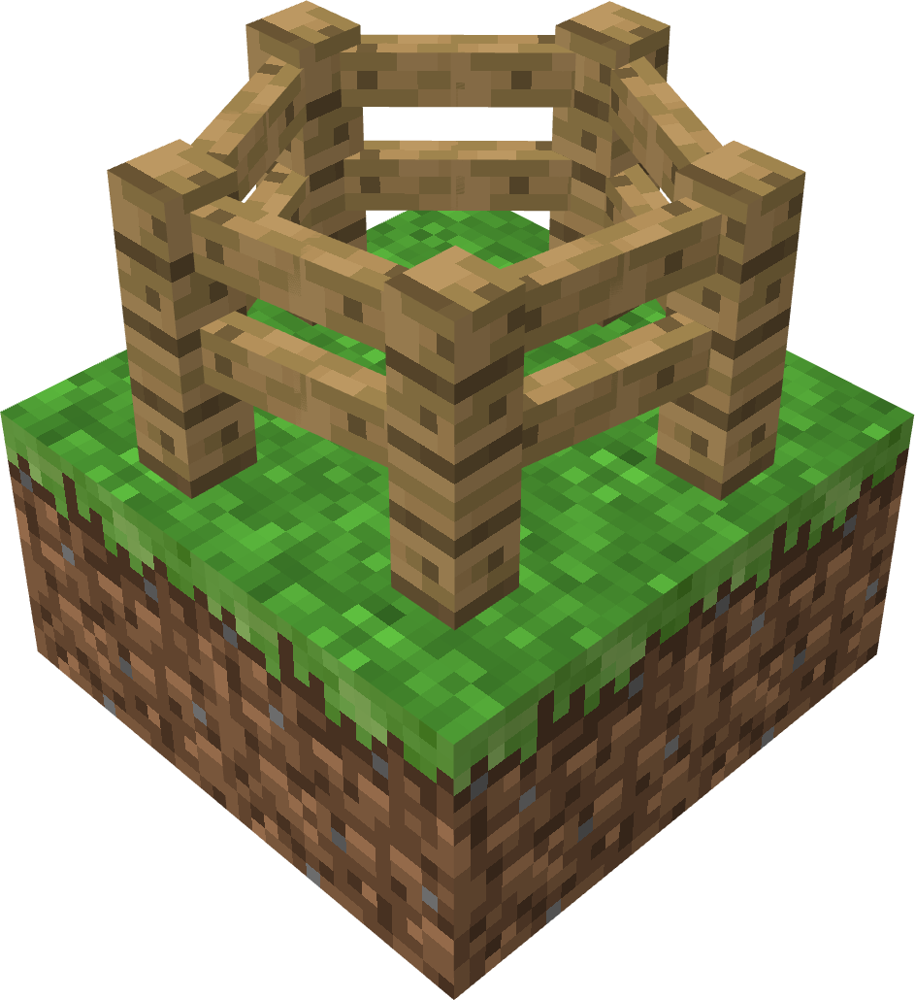
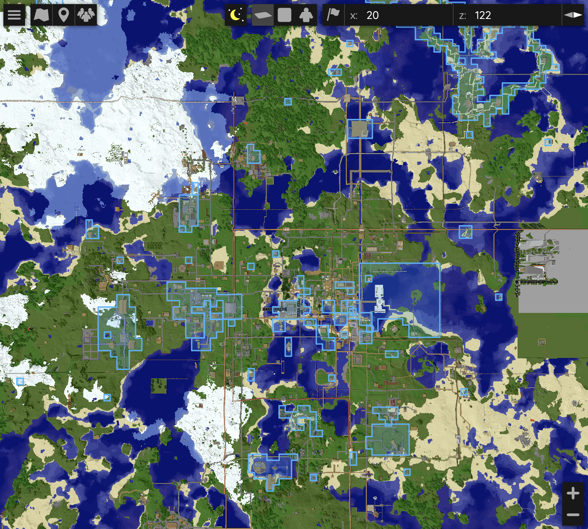
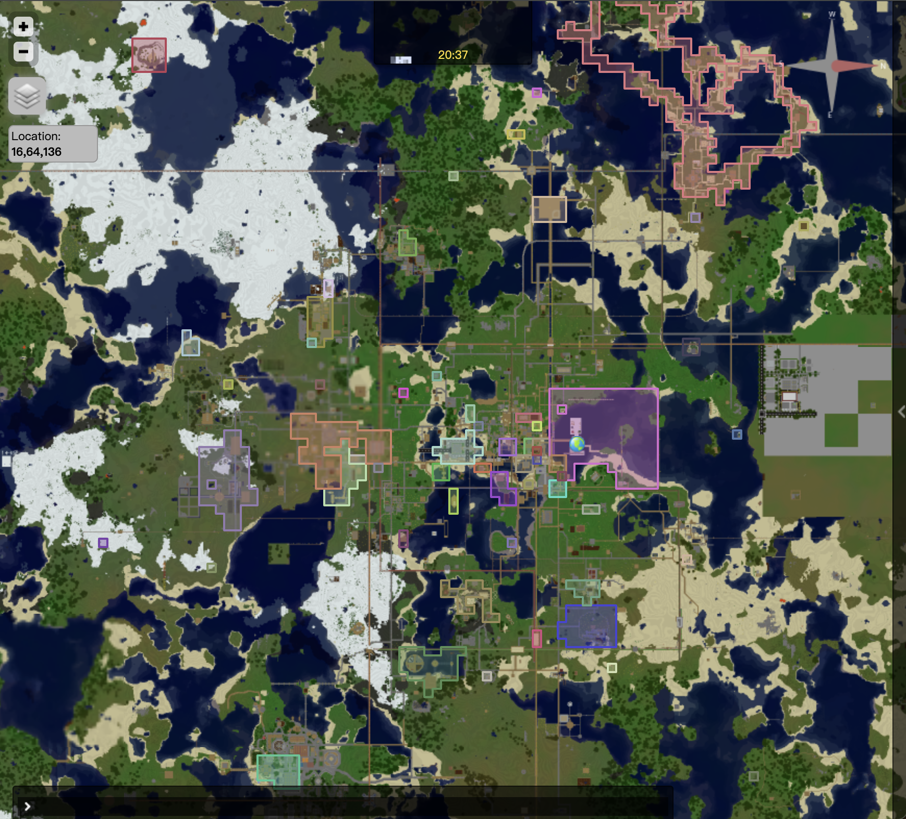
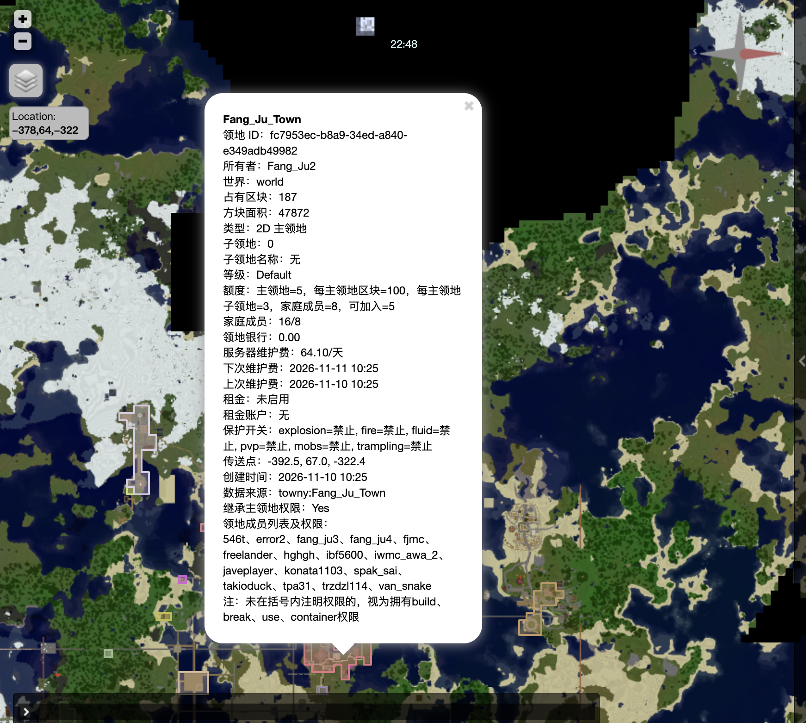

> This guide is written for players. It contains only the player-facing parts of the main documentation and omits administrator-only features.
>
> It avoids technical terminology wherever possible and uses plain-language explanations.
>
> All values shown in this guide are the plugin defaults.

<br><p align="center">
  
</p><br>

<h1>BetaLands Player Guide</h1>

<p align="center"><b>English</b> · <a href="PlayerWiki-zh.md">简体中文</a></p>

## 1 Player Quick Start

> In these examples, `AAA` is a main land, `AAA.bb` is a subclaim, and `steve` is a player name.

| Step | Action |
| :--- | :--- |
| 1. Create a main land | Stand in an unclaimed chunk and run `/land create AAA`. The 16×16 block area under your feet is claimed, and your current position becomes the land spawn. |
| 2. Expand the land | Stand in an adjacent unclaimed chunk and run `/land claim`. Use `/land claim auto` to toggle automatic claiming. While enabled, the plugin claims each new chunk you walk into. Run the command again to turn it off. |
| 3. Create a subclaim | If needed, select two corners inside `AAA` with a wooden hoe, or use `/land pos1` and `/land pos2`. Then run `/land subcreate bb`. |
| 4. Add a player | Stand inside the target land and run `/land add steve`. The player receives the default permissions: `build`, `break`, `use`, `container`, and `rent`. The target must be online and must run `/land accept <land>` before joining. |
| 5. Kick or leave | The land owner can stand inside the land and run `/land kick steve`. A joined player can run `/land leave` while inside the land. |
| 6. Set the land spawn | Stand inside the land and run `/land setspawn`. Teleport to the land with `/land spawn` or `/land tp`. |
| 7. Land bank | View: `/land bank info`; deposit: `/land bank deposit 100`; withdraw: `/land bank withdraw 50`. |
| 8. Land rent | Set: `/land rent set 5`; prepay: `/land rent deposit 30`; view: `/land rent info`. |
| 9. Land logs | Use `/land list`, `/land info`, and `/land logs 100`. |

## 2 Map Markers

Map details show the land ID, world, occupied chunks, area, type, number of subclaims, level limits, family member count, bank balance, maintenance and rent timing, spawn point, creation time, source, and whether the land inherits parent permissions.

<table>
  <tr>
    <td align="center" width="33%">
      
      <br>
      <sub>Refreshes 15 seconds after a land change</sub>
    </td>
    <td align="center" width="33%">
      
      <br>
      <sub>Refreshes daily at 01:00</sub>
    </td>
    <td align="center" width="33%">
      
      <br>
      <sub><b>Land detail card on the web map</b></sub>
    </td>
  </tr>
</table>

## 3 Player Commands

| Command | Description | Command | Description |
| --- | --- | --- | --- |
| `/land` / `/land help` | Command help | `/land create <name>` | Create a main land |
| `/land claim [main-land]` | Expand into an adjacent chunk | `/land claim auto [main-land]` | Toggle automatic claiming |
| `/land unclaim [main-land]` | Remove the current chunk without a refund | `/land info [land]` | View land information |
| `/land list [player]` | View a land list | `/land level` | View your level, limits, and rates |
| `/land playtime [player]` | View online-time progress | `/land delete [land]` | Request deletion and show confirmation |
| `/land pos1` / `/land pos2` | Set subclaim corners | `/land subcreate <subclaim-name>` | Create a 3D subclaim |
| `/land flags [land]` | View protection flags | `/land flag <flag> <allow\|deny\|default> [land]` | Change a protection flag |
| `/land add <player> [land]` | Invite a player | `/land kick <player> [land]` | Remove a member |
| `/land accept <land>` | Accept a land invitation | `/land deny <land>` | Decline a land invitation |
| `/land leave [land]` | Leave a land | `/land logs [count] [land]` | View land logs |
| `/land rename <new-name> [land]` | Rename a land | `/land setowner <online-player> [land]` | Transfer main-land ownership |
| `/land perm <player> <permission> <allow\|deny> [land]` | Change a member permission | `/land setspawn [land]` | Set the land spawn |
| `/land spawn [land]` / `/land tp [land]` | Teleport to a land | `/land delete confirm <land>` | Confirm and delete a land |
| `/land bank info [land]` | View the land bank and upkeep | `/land bank deposit <amount> [land]` | Deposit into the land bank |
| `/land bank-all info` | View all owned main-land banks and upkeep | `/land bank-all deposit <amount>` | Deposit into all main-land banks by upkeep share |
| `/land bank withdraw <amount> [land]` | Withdraw from a land bank | `/land rent set <amount> [land]` | Set the daily rent |
| `/land rent deposit <amount>` | Prepay into the global rent account | `/land rent withdraw <amount>` | Withdraw from the global rent account |
| `/land rent info [land]` | View rent and prepaid account information | `/land rent set 0 [land]` | Disable daily rent |

Land names belong at the end of a command. If the land name is omitted, BetaLands first uses the current land you are allowed to manage; otherwise it automatically selects your main land only when you own exactly one.

Land deletion takes two steps: run `/land delete [land]`, then `/land delete confirm <land>`. The second command must include the land name. The main-land bank must be exactly `0` before deletion. If the bank is in debt, the plugin shows a `/land bank deposit <amount> [land]` command to clear it. If a prepaid balance remains, the plugin shows a `/land bank withdraw <amount> [land]` command first.

## 4 Land Rules and Costs

Land names may contain only ASCII letters, digits, underscores, and hyphens. They cannot contain dots. Length is controlled by `limits.min-name-length` and `limits.max-name-length`, with defaults of `2–24`. Active land names are globally unique. Once a soft-deleted land no longer uses a name, that name can be used again.

`/land unclaim` removes only the main-land chunk you are currently in. A subclaim in that chunk must be deleted first. A main land must keep at least one chunk. If you remove the chunk containing the saved spawn, the explicit spawn is cleared.

A 3D subclaim must be fully inside its main land. Subclaims cannot overlap sibling subclaims in the same horizontal area and overlapping Y range. Two subclaims may share the same X/Z footprint when their Y ranges are completely separate.

### 4.1 Member Permissions

| Permission | Effect |
| --- | --- |
| `build` | Place blocks and empty buckets |
| `break` | Break blocks and fill buckets |
| `use` | Doors, buttons, levers, and similar interactions |
| `container` | Chests, furnaces, dispensers, and similar containers |
| `rent` | Pay daily rent as a member of the land; granted by default |
| `pvp` | Damage players inside the land |
| `manage` | Manage members, permissions, flags, and the land spawn |
| `all` | Grant every grantable permission |

Rules:

- Membership in a main land applies to that main land and its subclaims. Membership in a subclaim grants permissions only in that subclaim.
- `/land add` grants `build`, `break`, `use`, `container`, and `rent` by default. When `protection.allow-pvp-by-default: true`, it also grants `pvp`.
- The owner never pays rent for their own land. Ownership does not depend on the `rent` permission. Other members pay rent only when the land has rent enabled and they have the effective `rent` permission.
- Only effective `build` permission counts toward the number of lands a player has joined.

### 4.2 Protection Flags

| Flag | Global default |
| --- | ---: |
| `explosion` | `deny` |
| `fire` | `deny` |
| `fluid` | `deny` |
| `pvp` | `deny` |
| `tp` | `allow` |
| `mobs` | `allow` |
| `trampling` | `allow` |

Effective precedence is:

```text
subclaim override > main-land override > global default
```

`tp` controls public teleport access. It defaults to `allow`. When disabled, only the owner, members, and administrators may teleport to the land. If the land has maintenance debt, actual members cannot teleport there. Non-members can still use public teleport while `tp=allow`.

### 4.3 Land Levels

Your land level depends on your permission group.

Limits:

| Level | Permission | Main lands | Chunks per main land | Subclaims per main land | Family members | Joined lands | Maintenance interval |
| --- | --- | ---: | ---: | ---: | ---: | ---: | ---: |
| Default | `betalands.level.default` | 5 | 200 | 3 | 6 | 6 | 3 days |
| VIP | `betalands.level.vip` | 15 | 400 | 20 | 20 | 30 | 3 days |
| SVIP | `betalands.level.svip` | 30 | 1000 | 100 | 60 | 100 | 3 days |

Prices:

| Level | Create land | Base expansion | Expansion increment per chunk | Subclaim per block | Upkeep per chunk/cycle | Upkeep per member/cycle |
| --- | ---: | ---: | ---: | ---: | ---: | ---: |
| Default | 300.00 | 20.00 | 5.00 | 0.01 | 0.20 | 0.30 |
| VIP | 250.00 | 20.00 | 4.00 | 0.008 | 0.15 | 0.25 |
| SVIP | 200.00 | 20.00 | 3.00 | 0.005 | 0.10 | 0.20 |

Maintenance chunk and member rates are charged once per maintenance cycle, not per day. The cycle length comes from the level's `maintenance-interval-days`.

## 5 Land Maintenance

Maintenance works as follows:

```text
server rate per chunk/member per maintenance cycle
→ main-land owner deposits into the land bank
→ one cycle fee is charged each time the configured interval is completed
→ successfully collected amounts accumulate in BetaLands' internal server maintenance bank
```

The land bank balance represents both maintenance prepayment and debt:

```yaml
/land bank info [land]             # View maintenance information
/land bank deposit <amount> [land] # Deposit maintenance prepayment
/land bank withdraw <amount> [land]# Withdraw unused prepaid funds
```

A positive balance is prepaid maintenance. A negative balance is debt. Deposits clear debt first, and any remaining amount becomes prepaid maintenance.

The "per member/cycle" rate uses unique effective members across the main land and all subclaims. The main-land owner is excluded, and only players with effective `build` permission in the main land or at least one subclaim are counted. A player with access in multiple family lands is counted once. Members without effective `build` permission are not charged as maintenance members.

## 6 Land Rent

The main-land owner can set daily rent on a main land or subclaim. Rent is charged only to members with the effective `rent` permission in that specific land. The owner never pays rent for their own land. Setting a member's `rent` permission to `deny` removes them from rent charges and rent reminders for that land.

```yaml
/land rent set <amount> [land]         # Set the member rent
/land rent set 0 [land]                # Disable rent
/land rent deposit <amount>            # Deposit into the global rent account; no land argument
/land rent withdraw <amount>           # Withdraw from the global rent account; no land argument
/land rent info [land]                 # View rent information
```

Each player has one server-wide rent account, regardless of how many rented lands they belong to. All rent charges use this account.

`/land rent deposit <amount>` operates only on the global account and does not accept a land name. The player must have at least one active rent obligation or unpaid rent. The amount then goes directly into the global account; it is not split by land and does not require the player to stand inside a land.

`/land rent withdraw <amount>` also operates only on the global account and does not accept a land name. `/land rent set` and `/land rent info` still accept an optional land because they configure or inspect a specific land.

When multiple lands charge rent at the same time, charges are processed from the lowest daily rent to the highest:

```text
Enough balance: all due rent is charged automatically.
Not enough balance: lower-rent lands are paid first until the account becomes negative.
The land that causes the negative balance receives the debt.
A later deposit pays that debt first and transfers the covered amount to the corresponding land owner.
Any remaining deposit stays as global prepaid rent.
```

## 7 Debt Restrictions

If the prepaid maintenance balance is below the next cycle charge but is not negative, BetaLands only sends a maintenance reminder and does not block actions. The rent account still uses a seven-day rental balance threshold.

| Area | Main-land bank debt | Rent account debt |
| --- | --- | --- |
| Blocked actions | Expanding a land, creating a subclaim, adding or removing members, adding `build` through `/land perm`, land teleport, and protected building, breaking, buckets, doors, buttons, containers, and similar interactions. Withdrawals are also blocked. Each completed maintenance cycle continues to increase the debt. | Withdrawing from the rent account. Protected building, breaking, buckets, doors, buttons, containers, and similar interactions in the land that owns the debt. Teleporting to that land. If the debt belongs to a main land, its subclaims receive the same restriction. Daily rent processing pauses while the account is negative; later charges skipped because of the negative balance are not retroactively collected. |
| Allowed actions | `/land unclaim`, voluntarily leaving as a normal member, viewing logs, and `/land bank deposit` to clear debt. Debt must be cleared and deletion confirmed before deletion. Debt never automatically deletes a land or removes members. A deposit clears debt first, then becomes prepaid maintenance. | `/land rent deposit` to clear debt and `/land rent info`. Other lands without debt are not restricted. Rent debt by itself does not block member changes or land expansion, though main-land bank debt may still do so. A deposit pays the debt owner first, and the remainder becomes global prepaid rent. |

### 7.1 Fee Reminders

- After joining, a player receives a fee summary covering maintenance for their owned main lands and rent they owe as a rent-paying member.
- If an owned main-land bank cannot cover the next maintenance cycle, or a member's prepaid rent covers fewer than seven days, affected online players receive a reminder once per minute.
- Outstanding debt uses the debt reminder. Lands without upkeep or rent do not generate duplicate warnings.

Rent and maintenance reminders inspect the land bank and rent account, not the player's total personal balance.

---

<br><br><br>

<p align="center">
  
</p>
