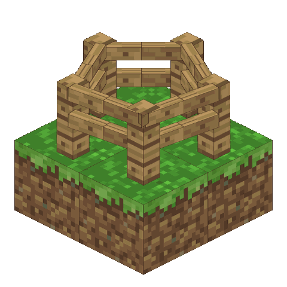
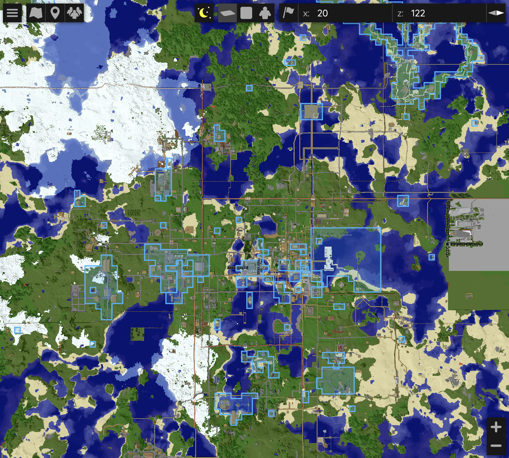
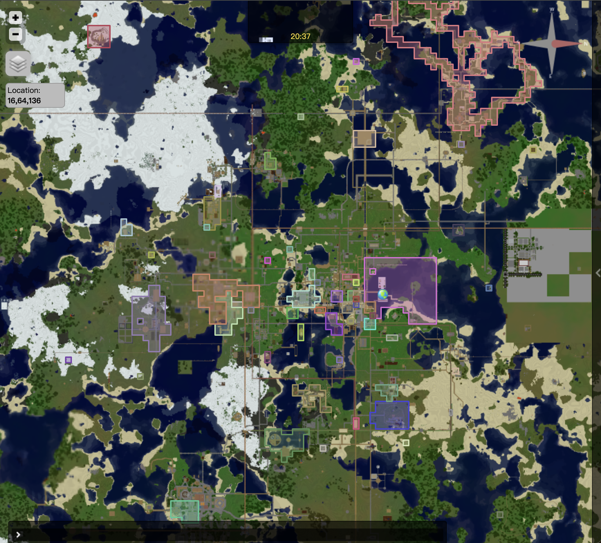
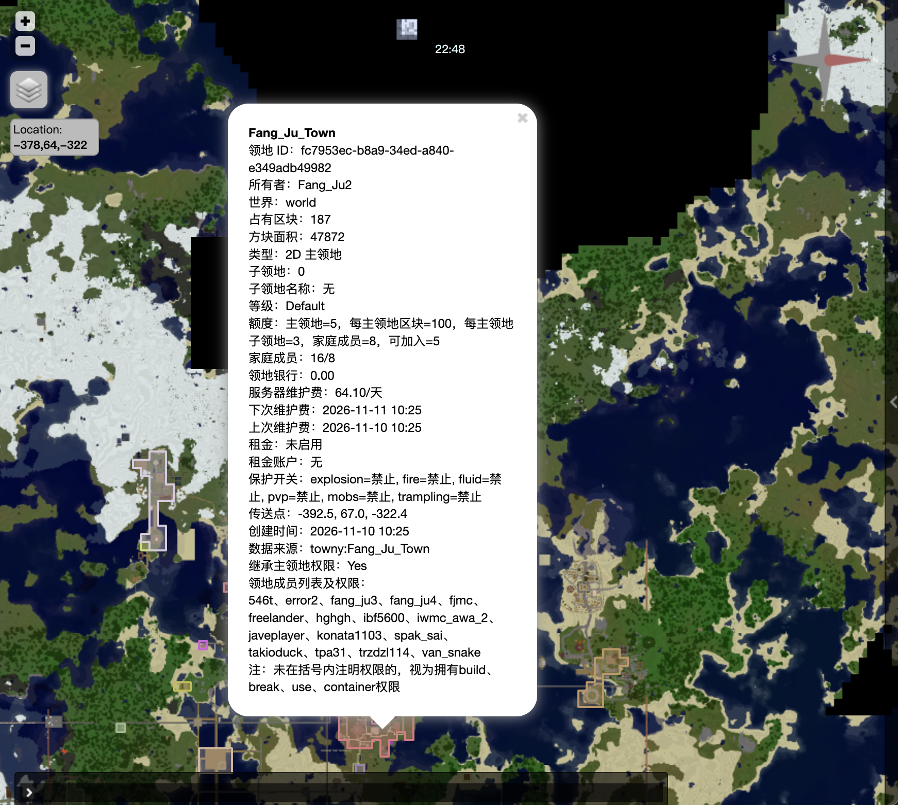
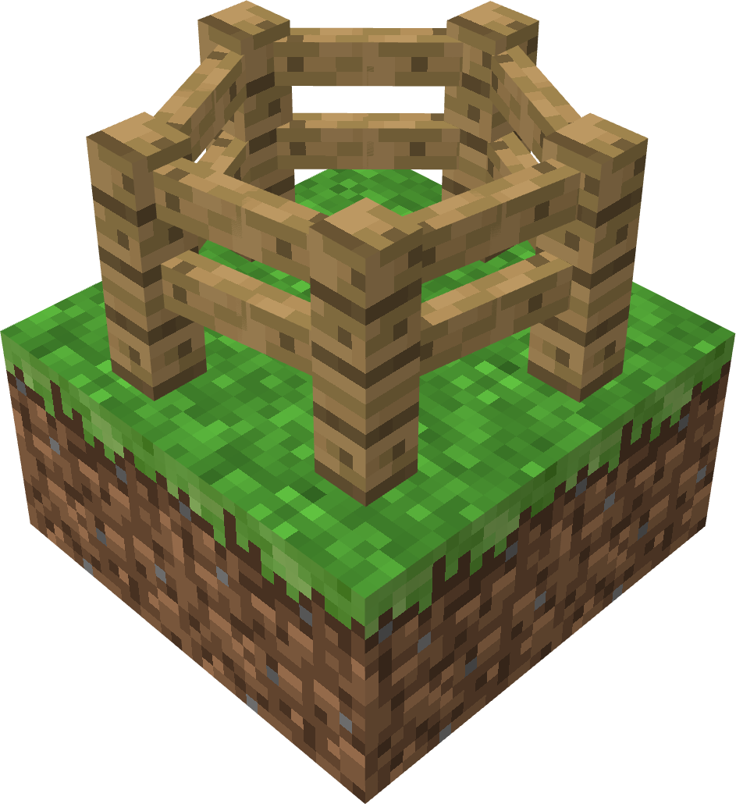

  

<h1 align="center">BetaLands</h1>

2D main lands and 3D subclaims for Minecraft Beta 1.7.3 / Project Poseidon.

  
  
  
  

<b>English</b> · <a href="README-zh.md">简体中文</a>

BetaLands is a land-protection and land-management plugin designed for Minecraft Beta 1.7.3 servers running Project Poseidon. It combines chunk-based main lands, vertically bounded subclaims, member permissions, protected interactions, land banks, rent, level quotas, map markers, audit logs, and Towny migration.

| BlueMap | Dynmap | Land Details |
| :---: | :---: | :---: |
|  |  |  |

## Highlights

- Main lands use connected 16×16 chunk coverage with automatic or manual expansion.
- Subclaims use 3D selections and support vertically stacked, independent protected areas.
- Per-member permissions cover building, breaking, interaction, containers, rent, PVP, and land management.
- Separate protection flags control explosions, fire, fluid crossing, PVP, public teleport, mob spawning, and trampling.
- Level-based limits and prices can be configured through Bukkit permissions and `levels.yml`.
- Persistent temporary levels are stored in the database and revert automatically when they expire.
- Land banks prepay maintenance and can enter debt. Debt blocks protected actions and selected management operations until paid.
- Each player has one global rent account. Rent can be configured per main land or subclaim.
- BlueMap and Dynmap integrations display land outlines, holes, subclaim heights, member permissions, financial state, and other details.
- Towny towns and resident plots can be migrated to main lands and 3D subclaims.
- SQLite, MySQL/MariaDB, and TSV storage backends are supported.
- A read-only Bukkit `ServicesManager` API is available for other plugins.

## Compatibility

| Component | Requirement |
| --- | --- |
| Server | [Project-Poseidon](https://github.com/retromcorg/Project-Poseidon) / Minecraft Beta 1.7.3 |
| Java | Java 8 |
| Economy | [iConomy 5.01](https://www.reddit.com/r/GoldenAgeMinecraft/s/UDZmFBgxf4) |
| Optional | [Towny 0.76](https://bukkit.org/threads/157978/), [Dynmap 0.24](https://dev.bukkit.org/projects/dynmap/files/552350), [BlueMap b173](https://github.com/Moresteck/BlueMap) |

## Documentation

- [Full English documentation](README.md)
- [English player guide](PlayerWiki.md)
- [完整中文文档](README-zh.md)
- [中文玩家指南](PlayerWiki-zh.md)
- [中文 API 文档](API-zh.md)

## Sponsorship

If this project is useful to you, you can support development through Ko-fi or Afdian. Sponsors can receive help with installation, configuration, and troubleshooting.

  
  

   

  

