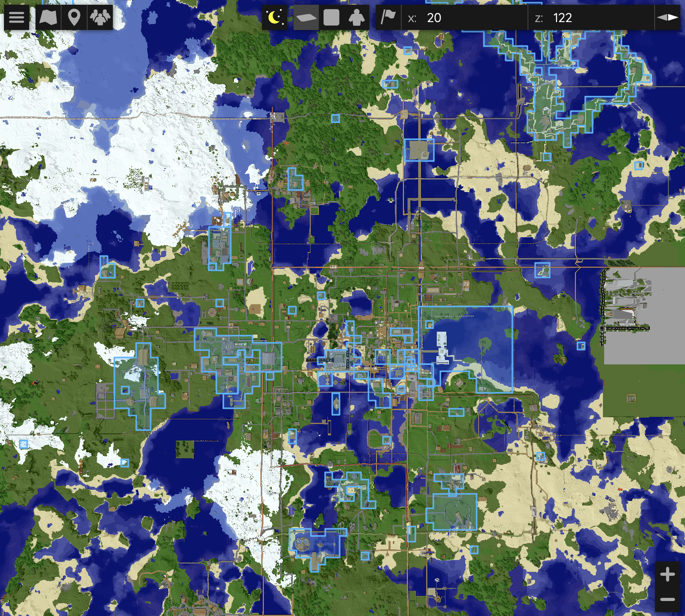
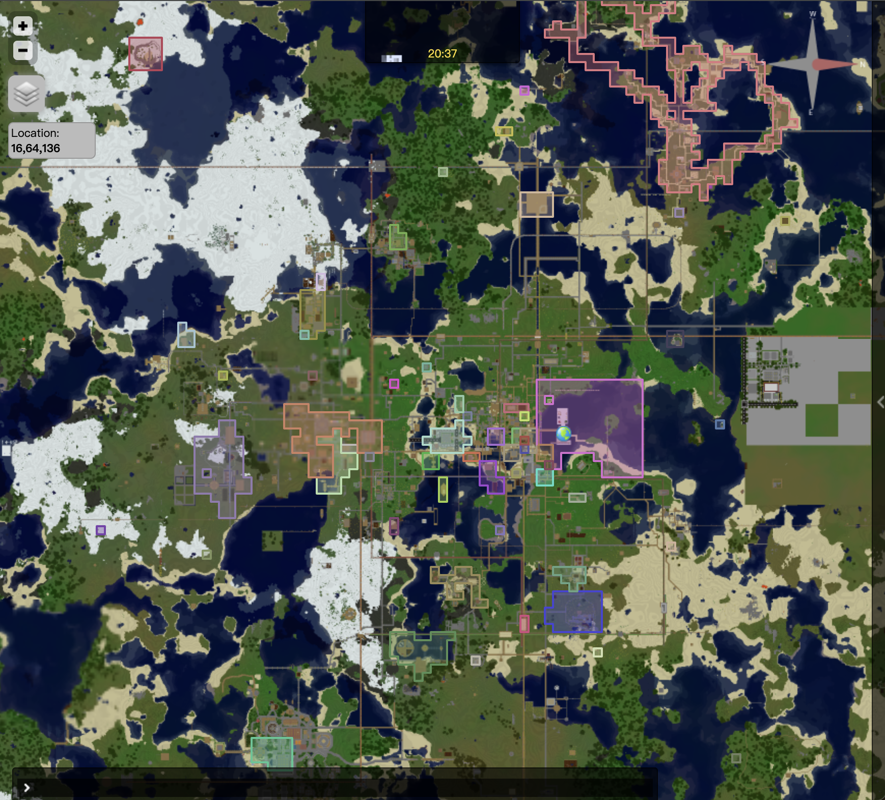
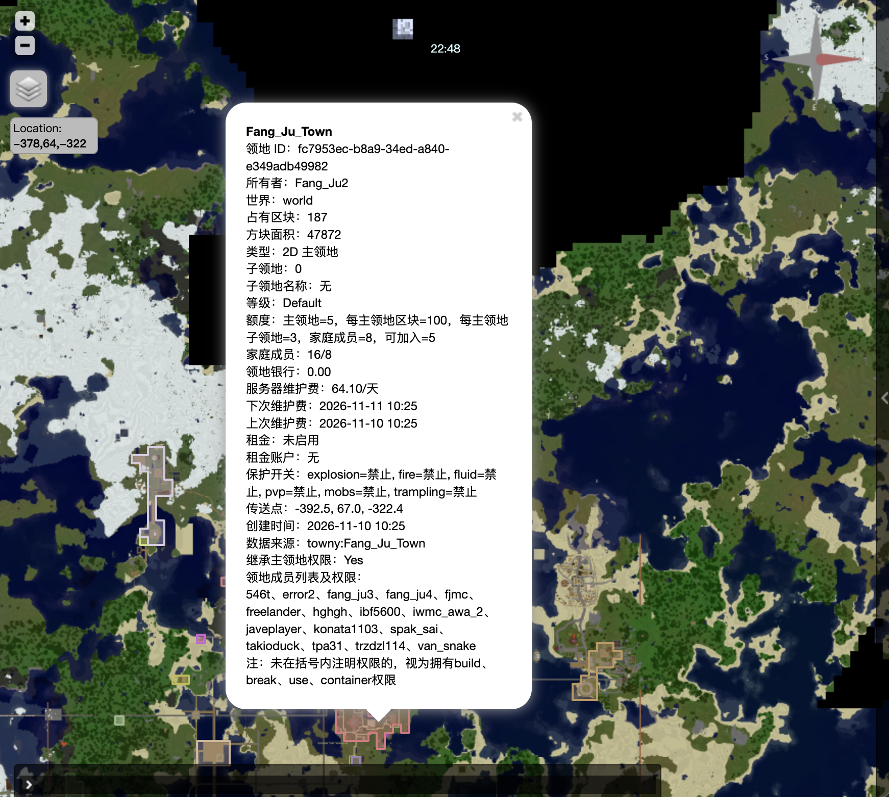

<p align="center">
  
</p>

<h1 align="center">BetaLands</h1>

<p align="center">Minecraft Beta 1.7.3 / Project-Poseidon 领地保护插件</p>

<p align="center">
  
  
  
  
  <a href="https://bstats.org/plugin/bukkit/BetaLands/35249"></a>
</p>

现代化的 Beta1.7.3 领地保护插件，主领地采用2D区块保护，子领地采用3D方块保护，领地范围与信息可集成BlueMap/Dynmap显示，支持从 Towny 进行数据迁移。

玩家使用说明：[PlayerWiki.md](PlayerWiki.md)

其他插件可以通过 Bukkit `ServicesManager` 查询领地数据 [API.md](API.md)。

## 功能展示

<table>
  <tr>
    <td align="center" width="33%">
      
      <br>
      <sub><b>BlueMap</b>：领地范围</sub>
    </td>
    <td align="center" width="33%">
      
      <br>
      <sub><b>Dynmap</b>：领地范围</sub>
    </td>
    <td align="center" width="33%">
      
      <br>
      <sub><b>地图中领地详情标签</sub>
    </td>
  </tr>
</table>

## 1 兼容与安装

| 项目 | 要求 |
| --- | --- |
| 服务端 | [Project-Poseidon](https://github.com/retromcorg/Project-Poseidon) / Minecraft Beta 1.7.3 |
| Java | Java 8 编译目标 |
| 经济 | [iConomy](https://www.reddit.com/r/GoldenAgeMinecraft/s/UDZmFBgxf4) 5.01 |
| 可选 | [Towny](https://bukkit.org/threads/157978/) 0.76、[Dynmap](https://dev.bukkit.org/projects/dynmap/files/552350) 0.24、[BlueMap](https://github.com/Moresteck/BlueMap) b173 |

## 2 玩家流程示例

> 示例中 `AAA` 是主领地，`AAA.bb` 是子领地，`steve` 是玩家名。

| 步骤 | 操作 |
| :--- | :--- |
| 1、创建主领地 | 站在无主区块执行 `/land create AAA`。圈占脚下 16×16 区块，当前位置自动成为传送点。 |
| 2、扩展领地范围 | 站在接壤无主区块执行 `/land claim`。自动圈地使用 `/land claim auto`，再次执行关闭。（自动圈地是走到哪个区块中，自动圈地哪个区块） |
| 3、创建子领地 | （如果有子领地需求）在 `AAA` 内用木锄左键/右键选点，或使用 `/land pos1`、`/land pos2`；然后执行 `/land subcreate bb`。 |
| 4、领地添加玩家 | 站在目标领地内执行 `/land add steve`，自动授予基础权限。（`build、break、use、container、rent`）。目标玩家需在线且执行 `/land accept <领地>` 同意加入领地  |
| 5、踢出或退出 | 领地主在领地内执行 `/land kick steve`；玩家在领地内执行 `/land leave`。 |
| 6、领地传送 | 站在领地内执行 `/land setspawn`；使用 `/land spawn` 或 `/land tp` 传送。 |
| 7、领地银行 | 查看：`/land bank info`；存款：`/land bank deposit 100`；取款：`/land bank withdraw 50` |
| 8、领地租金 | 设置：`/land rent set 5`；预缴：`/land rent deposit 30`；查看：`/land rent info` |
| 9、领地日志 | `/land list`、`/land info`、`/land logs 100` |

## 3 指令大全

### 3.1 玩家指令

| 指令 | 说明 | 指令 | 说明 |
| --- | --- | --- | --- |
| `/land` / `/land help` | 指令帮助 | `/land create <名称>` | 创建主领地 |
| `/land claim [主领地]` | 扩展接壤区块 | `/land claim auto [主领地]` | 开关自动圈地 |
| `/land unclaim [主领地]` | 移除当前所在区块，不退费 | `/land info [领地]` | 查看领地信息 |
| `/land list [玩家]` | 查看领地列表 | `/land level` | 查看自己的等级、额度和费率 |
| `/land playtime [玩家]` | 查看在线时间进度 | `/land delete [领地]` | 请求删除领地并显示二次确认 |
| `/land pos1` / `/land pos2` | 设置子领地选点 | `/land subcreate <子领地名>` | 创建 3D 子领地 |
| `/land flags [领地]` | 查看保护开关 | `/land flag <开关> <allow\|deny\|default> [领地]` | 修改保护开关 |
| `/land add <玩家> [领地]` | 添加玩家 | `/land kick <玩家> [领地]` | 踢出玩家 |
| `/land accept <领地>` | 接受领地邀请 | `/land deny <领地>` | 拒绝领地邀请 |
| `/land leave [领地]` | 退出领地 | `/land logs [数量] [领地]` | 查询领地日志 |
| `/land rename <新名称> [领地]` | 修改领地名称 | `/land setowner <在线玩家> [领地]` | 转移主领地主人 |
| `/land perm <玩家> <权限> <allow\|deny> [领地]` | 修改成员权限 | `/land setspawn [领地]` | 设置领地传送点 |
| `/land spawn [领地]` / `/land tp [领地]` | 领地传送 | `/land delete confirm <领地>` | 二次确认并删除领地 |
| `/land bank info [领地]` | 查看领地银行和维护费 | `/land bank deposit <金额> [领地]` | 存入领地银行 |
| `/land bank-all info` | 查看自己全部主领地银行和维护费 | `/land bank-all deposit <金额>` | 按维护费比例批量存入全部主领地 |
| `/land bank withdraw <金额> [领地]` | 从领地银行取款 | `/land rent set <金额> [领地]` | 设置每日租金 |
| `/land rent deposit <金额>` | 向全局租金账户预缴租金 | `/land rent withdraw <金额>` | 从全局租金账户取款 |
| `/land rent info [领地]` | 查看租金和预缴账户 | `/land rent set 0 [领地]` | 关闭每日租金 |

地名统一放在指令末尾。省略地名时优先使用玩家当前站立且有权管理的领地；否则仅当玩家恰好拥有一个主领地时自动选择它。

删除领地分两步：先执行 `/land delete [领地]`，再执行 `/land delete confirm <领地>` 才会删除。删除前主领地银行必须为 `0`：欠费时会提示使用 `/land bank deposit <金额> [领地]` 补缴欠款；有预缴余额时会提示使用 `/land bank withdraw <金额> [领地]` 取走余额。

领地删除采用软删除。数据库保留领地、区域和成员记录，通过 `is_deleted=1` 标记删除状态，`deleted_at` 记录删除时间，`deleted_by` 记录触发删除的玩家或控制台，并把 `name_key` 改为不会占用活动名称空间的归档键。删除后的领地不再参与查询、地图、保护、额度和名称唯一性判断，可以重新创建同名领地。


### 3.2 管理员指令

需要 `betalands.admin` 或 OP：

| 指令 | 说明 | 指令 | 说明 |
| --- | --- | --- | --- |
| `/land admin` | 查看管理员指令用法 | `/land admin maintenance-exempt <true\|false> [领地]` | 设置维护费豁免 |
| `/land admin-land <玩家指令> ...` | 以管理员身份执行玩家领地指令 | `/land admin-land-force <玩家指令> ...` | 绕过部分限制，强制执行指令。下文说明允许绕过的判定 |
| `/land admin tp <x> <y> <z>` | 传送到当前世界坐标 | `/land admin tp <x> <y> <z> <世界>` | 传送到指定世界坐标 |
| `/land admin version` | 查看插件版本、JAR 文件名、SHA-256，以及 Dynmap、BlueMap、iConomy 的 hook 状态 | `/land admin server-bank` | 查看服务器累计维护费 |
| `/land admin status` | 查看领地、玩家、经济和等级状态 | `/land admin refresh-map [dynmap\|bluemap\|all]` | 立即刷新指定或全部地图 |
| `/land admin level [玩家]` | 管理员查看在线或离线玩家的领地等级 | `/land admin setlevel <玩家> <等级> <天数\|permanent>` | 授予插件等级 |
| `/land admin logs [条数\|页码]` | 全局日志查询 | `/land admin logs land <领地> [条数\|页码]` / `/land admin logs player <玩家> [条数\|页码]` | 支持最近条数或 `pN` 分页 |
| `/land admin save` | 后台保存最新状态 | `/land admin reload` | 重载可热更新配置和等级 |

### 3.2.1 管理员强制指令

管理员或 OP 在自己的领地中可以直接使用普通玩家指令；管理他人领地时可以统一使用 `/land admin-land <玩家指令> ...`。
例如：`/land admin-land add <玩家> <领地>` 会直接添加成员，并检查家庭成员数量、目标玩家的加入领地数量及欠费限制。

`admin-land` 不能代替玩家执行 `/land accept`、`/land deny` 和 `/land leave`，这些个人成员操作必须由受影响玩家本人执行。

**/land admin-land-force 会放行的行为：**

- `/land admin-land-force add <玩家> <领地>`：
  不检查领地银行是否欠费；绕过家庭人数和目标玩家可加入领地数量限制；玩家添加后仍会因欠费受到正常建造保护限制，直到补缴。
- `/land admin-land-force create`、`claim`、`claim auto`、`subcreate`：
  不检查等级额度、主领地面积、主领地区块数、子领地数量/体积及欠费；同时不收取创建或扩展费用。
- `/land admin-land-force kick`、`perm`：
  欠费时仍可踢人或修改权限；`perm` 新增 `build` 权限时忽略家庭人数和玩家加入额度。
- `/land admin-land-force bank withdraw <金额> <领地>`：
  可以超过当前领地银行余额；领地银行会被强制取款变为负数。
- `/land admin-land-force delete <领地>`：
  不要求二次确认；不要求银行余额为 0；原银行余额会被直接丢弃；主领地及其全部子领地会被标记为删除。
- `/land admin-land-force spawn`、`tp <领地>`：
  不再检查领地维护费或管理员租金欠费。
- `/land admin-land-force setspawn <领地>`：
  不要求管理员站在领地范围内；使用管理员当前位置作为传送点；仍要求当前位置与目标领地处于同一世界。

强制路径仍保留非法名称、非法金额、领地重叠、选区必须位于主领地内、目标世界存在等数据完整性检查；绕过这些检查会造成数据损坏或程序异常。

### 3.2.2 管理员查询日志

管理员日志查询使用显式过滤模式：

```yaml
/land admin logs [条数|pN]
/land admin logs land <领地> [条数|pN]
/land admin logs player <玩家> [条数|pN]
```

数字参数表示最近条数，例如 `/land admin logs 100` 返回最近 100 条，单次最多 200 条。`pN` 表示页码，每页固定 200 条：`p1` 是最新一页，`p2` 是第 201–400 条，后续依次类推。省略参数时默认查询最近 50 条。

### 3.3 玩家权限节点

以下节点默认授予普通玩家，管理员和 OP 自动通过玩家操作权限检查：

| 权限节点 | 作用 | 默认 |
| --- | --- | --- |
| `betalands.use` | 使用 `/land` 指令 | `true` |
| `betalands.create.main` | 创建主领地 | `true` |
| `betalands.create.claim` | 扩展主领地区块 | `true` |
| `betalands.create.subclaim` | 设置子领地选点和创建子领地 | `true` |
| `betalands.teleport` | 传送到有权访问的领地 | `true` |
| `betalands.member.invite` | 邀请玩家加入可管理领地 | `true` |
| `betalands.member.kick` | 踢出可管理领地的成员 | `true` |
| `betalands.member.permission` | 修改可管理领地的成员权限 | `true` |
| `betalands.land.rename` | 重命名可管理领地 | `true` |
| `betalands.land.setowner` | 转移可管理主领地 | `true` |
| `betalands.land.delete` | 请求删除可管理领地 | `true` |
| `betalands.land.flags` | 修改保护开关 | `true` |
| `betalands.land.setspawn` | 设置领地传送点 | `true` |
| `betalands.land.logs` | 查询可管理领地日志 | `true` |
| `betalands.bank.use` | 使用领地银行和批量存款 | `true` |
| `betalands.rent.use` | 设置租金、预缴或查询租金 | `true` |


## 4 领地规则与费用

领地名称只能包含 ASCII 字母、数字、下划线和连字符，不能包含点号；长度由 `limits.min-name-length` 和 `limits.max-name-length` 控制，默认 `2–24`。名称需要全局唯一，软删除后的旧名称可以重新使用。

`/land unclaim` 只能移除主领地当前所在的一个区块。目标区块上有子领地时必须先删除子领地；主领地至少保留一个区块；如果领地传送点所在的区块被移除，传送点会被清空。

3D 子领地的水平范围必须完整位于主领地内。同一水平范围内，子领地不能与其他兄弟子领地重叠；如果两个子领地的 Y 轴范围完全分离，则可以在相同水平坐标上下堆叠。

### 4.1 领地成员权限

成员权限：

| 权限 | 作用 |
| --- | --- |
| `build` | 放置方块、倒桶 |
| `break` | 破坏方块、盛桶 |
| `use` | 门、按钮、拉杆等 |
| `container` | 箱子、熔炉、发射器等 |
| `rent` | 作为该领地成员承担每日租金；默认授予 |
| `pvp` | 对领地内玩家造成伤害 |
| `manage` | 管理成员、权限、旗标和传送点 |
| `all` | 授予全部可授权项 |

规则：
- 加入主领地后，权限作用于主领地及其子领地,加入子领地只获得该子领地权限。
- `/land add` 默认授予 `build、break、use、container、rent`；当 `protection.allow-pvp-by-default: true` 时还会授予 `pvp`。
- 领地主不承担自己领地的租金，这是所有权规则，不依赖 `rent` 权限；其他成员只有拥有 `rent` 且领地租金启用时才会计费。
- 只有实际拥有 `build` 才计入“已加入领地数量”。

### 4.2 领地保护开关

| 开关 | 全局默认 |
| --- | ---: |
| `explosion` | `deny` |
| `fire` | `deny` |
| `fluid` | `deny` |
| `pvp` | `deny` |
| `tp` | `allow` |
| `mobs` | `allow` |
| `trampling` | `allow` |

子领地覆盖值优先，其次继承主领地，最后使用 `config.yml` 全局默认。

`tp` 是公众传送开关，默认 `allow`。关闭后只有领地主、成员和管理员能传送到该领地。领地欠费时，实际成员无法传送；非成员仍可按 `tp=allow` 公众传送到该领地。

### 4.3 等级配置

文件：`plugins/BetaLands/levels.yml`

默认数量：

| 等级 | 权限 | 主领地 | 每主领地最多占有区块 | 每主领地子领地最多数量 | 成员最大数量 | 可加入领地 | 维护收取间隔 |
| --- | --- | ---: | ---: | ---: | ---: | ---: | ---: |
| Default | `betalands.level.default` | 5 | 200 | 3 | 6 | 6 | 3 天 |
| VIP | `betalands.level.vip` | 15 | 400 | 20 | 20 | 30 | 3 天 |
| SVIP | `betalands.level.svip` | 30 | 1000 | 100 | 60 | 100 | 3 天 |

默认价格：

| 等级 | 创建领地 | 领地扩展基础价 | 领地扩展按照区块价格增量 | 子领地/方块 | 每区块维护/周期 | 每成员维护/周期 |
| --- | ---: | ---: | ---: | ---: | ---: | ---: |
| Default | 300.00 | 20.00 | 5.00 | 0.01 | 0.20 | 0.30 |
| VIP | 250.00 | 20.00 | 4.00 | 0.008 | 0.15 | 0.25 |
| SVIP | 200.00 | 20.00 | 3.00 | 0.005 | 0.10 | 0.20 |

同时拥有多个等级权限时（例如同时拥有VIP和SVIP时）使用 `priority` 最大的等级。

“主领地数量”在创建主领地时检查，也在 `/land setowner` 转移给目标玩家时检查；目标玩家已经达到其等级上限时不能接收更多主领地。

`levels.yml` 并不限于这三个示例等级。服务器可以在 `levels` 下添加任意等级 ID，并分别设置 `display-name`、`permission`、`priority`、各项额度、价格和维护费率。`default-level` 指定玩家没有任何等级权限时使用的等级。

维护费配置使用 `maintenance-per-chunk-per-cycle` 和 `maintenance-per-member-per-cycle`，表示每个维护周期的费用。旧配置中的 `maintenance-per-chunk-per-day` 和 `maintenance-per-member-per-day` 仍会继续读取，数值现在同样解释为每周期费用；如需使用新键名，请删除对应旧键。

### 4.4 持久化限时等级

插件会在数据库的玩家表中保存玩家等级、是否由插件接管以及到期时间。被管理员设置的插件等级优先于 Bukkit 等级权限；到期后自动恢复 Default，不依赖玩家在线。
例如：
```yaml
/land admin setlevel Steve vip 30 //设置玩家 Steve 拥有 BetaLands 的 VIP 权限组30天
/land admin setlevel Steve svip permanent //设置玩家 Steve 拥有 BetaLands 的 VIP 权限组永久
```

### 4.5 领地维护费

主领地维护费：
服务器规定每区块/每成员在每个维护周期的费用 → 主领地主人向领地银行预缴 → 每完成一个配置周期从领地银行扣除一次 → 扣款累计到 BetaLands 内部服务器维护银行

领地银行余额同时表示维护费预缴余额和欠费：

```yaml
/land bank info [领地]             //查询领地维护费信息
/land bank deposit <金额> [领地]    //向领地银行存钱，作为预缴的领地维护费
/land bank withdraw <金额> [领地]   //从领地银行取钱，取款未扣除的钱
```

领地银行余额为正时是预缴维护费；余额为负时是欠费。存款会先补平欠费，剩余部分继续作为预缴余额。

“每成员/周期”统计的是家庭有效成员数，不是主领地与各子领地成员数量的简单相加。插件会合并主领地及全部直接子领地的成员和子领地领地主，排除主领地领地主，只统计在主领地或任一子领地中实际拥有 `build` 权限的玩家。同一玩家在多个成员领地中拥有 `build` 权限时只计算一次；只有 `use`、`container` 等权限但没有有效 `build` 权限的玩家不计入维护费成员数。

主领地所有者可使用 `/land bank-all info` 查看自己全部主领地银行，并使用 `/land bank-all deposit <金额>` 从个人 iConomy 账户一次性扣款。金额按各主领地当前每周期维护费占全部维护费的比例分配，分摊结果精确到 `0.01`，所有领地到账金额之和等于实际扣款。没有维护费的主领地权重为 `0`；如果全部主领地都没有可计费维护费，则拒绝批量存款。该指令不提供取款，取款仍需逐领地使用 `/land bank withdraw`。

管理员执行 `/land admin maintenance-exempt true [领地]` 设置维护费豁免时，如果目标主领地银行已经为负数，会将该负数余额清零。重新关闭豁免不会自动恢复此前欠费。

玩家金额输入的小数位由 `economy.max-decimal-places` 控制，可设置为 `0`、`1` 或 `2`，默认 `2`：

```yaml
economy:
  max-decimal-places: 2
```

该限制适用于 `/land bank`、`/land bank-all` 和 `/land rent` 的所有金额参数。超过限制的输入会直接拒绝，不会自动四舍五入；同时会先检查字符串长度和数字格式，避免超长或异常数字造成解析压力。

修改 `storage.*`、MySQL 连接参数或 `save-interval-seconds` 后必须重启服务器；`/land admin reload` 不会重建存储后端或重新调度保存任务。

### 4.6 领地租金

主领地主人可以为主领地或子领地设置每日租金。租金只向当前领地中拥有 `rent` 权限的成员收缴，不向领地主收缴。将成员的 `rent` 权限设为 `deny` 后，该成员不再参与该领地的租金扣费和提醒。

```yaml
/land rent set <金额> [领地]         //设置领地成员的租金
/land rent set 0 [领地]             //设置租金为0
/land rent deposit <金额>           //向个人全局租金账户存钱，不接受领地参数
/land rent withdraw <金额>          //从个人全局租金账户取钱，不接受领地参数
/land rent info [领地]              //查询领地租金信息
```

每个玩家在全服只有一个租金账户，无论同时租用多少个领地，都从这个账户扣费。

`/land rent deposit <金额>` 只操作玩家的全局租金账户，不接受领地名称。玩家必须至少存在一个有效租金义务或租金欠费；满足后金额会直接进入全局账户，不按领地分配，也不要求在领地内执行。

`/land rent withdraw <金额>` 同样只操作全局租金账户，不接受领地名称。`/land rent set` 和 `/land rent info` 仍可指定领地，因为它们分别修改和查看具体领地的租金配置。

多个领地同时到期时，按每日租金从低到高依次扣除：

```yaml
账户余额充足：所有收取领地租金的会自动扣款
账户余额不足：先支付租金较低的领地，扣到账户为负数时停止
租金账户为负数时，欠费归属于最后扣除的那个领地。之后存款会先补这部分欠费并转给对应领地主，剩余金额继续作为该玩家的预缴租金。
```


### 4.7 欠费限制

预缴维护余额低于下一次维护周期费用但为非负数时，只发送维护提醒，不限制操作。租金账户继续按未来 7 天租金判断低余额提醒。

| 项目 | 主领地银行欠费 | 租金账户欠费 |
| --- | --- | --- |
| 禁止的行为 | 禁止扩展领地、创建子领地、添加或踢出成员、通过 `/land perm` 新增 `build` 权限、领地传送，以及领地内的建造、破坏、桶、门、按钮、容器等受保护操作。<br><br>禁止取款；每完成一个维护周期仍会继续扣费，银行负数会持续增加。 | 禁止从租金账户取款。<br><br>禁止在欠费所属领地建造、破坏、桶、门、按钮、容器等受保护操作；禁止传送到欠费领地。<br><br>欠费领地为主领地时，其子领地也受到相同限制。<br><br>后续每日扣费暂停，因负数而跳过的后续领地扣款不会自动补扣。 |
| 允许的行为 | 允许 `/land unclaim` 缩小领地、普通成员主动退出、查询日志和 `/land bank deposit` 补缴；删除领地前必须先补平银行欠费并通过二次确认。<br><br>欠费不会自动删除领地或踢出成员；补缴先清欠费，剩余部分成为预缴维护费。 | 允许 `/land rent deposit` 补缴和 `/land rent info` 查询。<br><br>其他没有欠费的领地不受建造和传送限制。<br><br>租金欠费本身不禁止添加或踢出成员、扩展领地，但这些操作仍可能被主领地银行欠费限制。<br><br>补缴先补给欠费领地主，剩余部分成为全局预缴租金。 |

### 4.8 费用提醒

- 玩家上线后会收到一次费用汇总，包括自己拥有的主领地银行维护费，以及自己作为租金成员需要支付的租金。
- 主领地银行余额低于下一个维护周期的维护费，或成员的预缴租金低于未来 7 天租金时，对应在线玩家每分钟收到一次提醒。
- 存在未缴欠费时使用欠费提醒；无维护费或未出租的领地不会产生重复警告。

提醒只检查领地银行和租金账户，而不是玩家个人的 iConomy 总余额。

提醒文案位于 `plugins/BetaLands/lang/game.yml` 的 `fees` 节点。

### 4.9 领地提示

玩家跨入或离开主领地、子领地时，BetaLands 会显示领地名称和主人。主领地显示为 `AAA`，子领地显示为 `AAA.bbb`；离开领地进入野外时显示 `Wilderness`。

```yaml
territory-messages:
  enabled: true
  show-wilderness: true
```

提示文本位于 `plugins/BetaLands/lang/game.yml` 的 `territory` 节点。

## 5 地图标记

- Dynmap：主领地和子领地使用两个独立标记组；不规则领地按连通区域绘制连续外轮廓，并独立绘制内洞。
- BlueMap：显示连通的领地轮廓、内洞和子领地 Y 轴范围。
- 地图详情会列出每个成员在当前领地的有效权限。默认的 `build`、`break`、`use`、`container`、`rent` 权限不逐个标注，其他权限在玩家名后的括号中注明。
- “保护开关”只显示允许或禁止，不再显示该开关继承自哪里。
- 地图详情同时显示领地 ID、世界、区块数、面积、类型、子领地数量、等级额度、家庭成员数、银行余额、维护和租金时间、出生点、创建时间、来源以及是否继承父领地权限。
- BlueMap 在领地变化后自动刷新；Dynmap 默认每天凌晨定时刷新。Dynmap 启动注入默认关闭；将 `startup-refresh` 设为 `true` 时，插件会在启动约 5 秒后注入一次标记。管理员也可立即刷新：

```text
/land admin refresh-map
/land admin refresh-map dynmap
/land admin refresh-map bluemap
```

Dynmap 启动注入可单独关闭：

```yaml
maps:
  dynmap:
    startup-refresh: false
```

默认关闭后不会在启动时注入标记，但仍按 `daily-refresh-hour/minute` 每日刷新；建议使用 `/land admin refresh-map dynmap` 手动同步。Dynmap 刷新在主线程执行，可能造成暂时卡顿。

BlueMap 和 Dynmap 分别调度。BlueMap 默认在领地变化后 15 秒刷新，Dynmap 默认每天服务器本地时间凌晨 `01:00` 刷新：

```yaml
maps:
  dynmap:
    enabled: true
    daily-refresh-hour: 1
    daily-refresh-minute: 0
  bluemap:
    enabled: true
    refresh-delay-seconds: 15
```

Dynmap 和 BlueMap 的启用开关相互独立，默认都为 `true`。

BlueMap 刷新采用按领地增量更新。Dynmap 为兼容 0.24 的标记加载方式，每次刷新都会先删除并重建 `betalands` 持久标记集；轮廓按边界线段创建细长矩形标记。

### 5.1 地图颜色、语言与显示方式

颜色可在 `config.yml` 中分别设置。必须使用带引号的 `#RRGGBB`，或使用 `auto` 保持默认效果：

```yaml
maps:
  colors:
    dynmap:
      main: auto
      subclaim: auto
    bluemap:
      main: auto
      subclaim: auto
```

Dynmap 的 `auto` 会根据领地主人生成颜色；BlueMap 的 `auto` 使用默认蓝色主领地和橙色子领地。修改颜色后执行 `/land admin reload`。

Dynmap 和 BlueMap 的图层名称、标记详情位于 `BetaLands/lang/map-zh.yml` 和 `map-en.yml`，通过 `config.yml` 的 `language.map` 选择。

Dynmap 是俯视地图，子领地标记可以显示水平范围和 Y 范围信息，但无法显示 BlueMap 那样的三维挤出柱体。

### 5.2 地图图层与玩家列表

Dynmap 的 `plugins/dynmap/configuration.txt` 必须同时保留以下两个组件：

```yaml
components:
  - class: org.dynmap.MarkersComponent
    type: markers

  - class: org.dynmap.ClientComponent
    type: playermarkers
    showplayerfaces: true
    hidebydefault: false
    label: "Players"
```

前者提供 Marker API，BetaLands 没有它就无法创建领地标记；后者提供在线玩家图层。若使用了 `/dynmap hide`，执行 `/dynmap show` 恢复显示。`display-whitelist: true` 时，`hiddenplayers.txt` 会被当作白名单，只有名单内玩家可见。

BlueMap 的 `plugins/BlueMap/plugin.conf` 应启用：

```yaml
live-player-markers: true
hidden-game-modes: ["spectator"]
hide-vanished: true
hide-invisible: true
```

BlueMap 内置网页服务需要 `webserver.conf` 中 `enabled: true`，并访问正确端口（默认 `8100`）。如果网页由外部服务器提供，则需要配置 `write-players-interval`，让 `live/players.json` 定期写入存储。Dynmap 默认网页端口为 `8123`。

修改地图配置后应完整重启地图插件或服务器，再确认浏览器图层菜单中 `Players`/玩家图层未被隐藏。只有在线玩家才会显示；玩家在旁观、隐身或消失状态时，BlueMap 会按上述配置隐藏。

### 5.3 Dynmap 切换维度后区域标记残留

Dynmap 0.24 版本在切换世界时没有清除旧区域标记，导致主世界领地在其他维度残留。BetaLands 的标记世界数据正确，这是 Dynmap 前端问题。

在 `plugins/dynmap/web/js/markers.js` 的 `removeAllMarkers()` 中，找到 `set.markers = {};`，在其后加入：

```javascript
$.each(set.areas, function(aname, area) {
    set.layergroup.removeLayer(area.our_area);
});
set.areas = {};
```

修改后清理浏览器缓存并强制刷新地图。也可使用 Dynmap 0.25+ 的前端资源，但需确认服务端兼容性。

### 5.4 Dynmap 刷新线程限制（已知问题）

Dynmap 0.24 版本的标记刷新目前在 Bukkit 主线程完成。会导致服务器卡顿；曾尝试改为类似 BlueMap 的异步构建和差量标记，但实际测试中 Dynmap 无法稳定显示标记，因此目前无法采用异步线程。默认将 Dynmap 刷新安排到每天凌晨 `01:00`，以降低在线高峰受到影响。

## 6 管理与维护

### 6.1 数据迁移

目前仅提供：Towny 数据迁移

```yaml
/land admin migrate-towny
/land admin migrate-towny /path/to/plugins/Towny
```

迁移前自动保存并备份 BetaLands 数据。Towny 文件读取、城镇区块转换、名称冲突处理和子领地生成都在后台串行执行；最终合并和地图刷新会回到服务器主线程。如果直接读取已加载的 Towny 实时对象，这部分读取必须先回到服务器主线程完成，之后的数据转换仍会在后台执行。Towny 城镇转换为主领地，居民 plot 可转换为 3D 子领地，并迁移 PVP、火焰、爆炸、生物和踩踏设置。

迁移开始、备份、转换、应用和完成过程都会输出到服务器控制台。迁移结果会立即应用到当前领地系统；数据库保存和地图刷新随后排队执行，无需重载插件。

Towny 城镇的 `isPublic` 不会导入。BetaLands 不提供公开加入领地的玩法，因此所有新迁移的主领地都会保存为“非公开”。

Towny 城镇名称会保留大小写，并把不支持的字符替换为连字符。正常情况下直接使用转换后的城镇名；只有与现有领地或其他已迁移领地重名时，才添加 `towny-` 前缀，后续冲突再追加 `-2`、`-3`。重名判断忽略大小写。重新迁移已有的 Towny 领地不会被自身旧名称误判为重名。

### 6.2 数据库日志

日志数据库：

```yaml
plugins/BetaLands/logs.db
```

- `land_logs`：领地、成员、权限、旗标、传送点和租金操作。
- `economy_logs`：创建费用、扩展费用、银行收支、租金和维护费。

日志异步写入，查询也不会阻塞服务器主线程；管理员关闭服务器时会等待写入完成。

管理员、控制台和 SYSTEM 触发的修改会写入 `admin_action` 标记。普通玩家执行 `/land logs` 时默认隐藏这些记录；管理员执行 `/land admin logs` 时始终包含它们。该行为可通过 `logs.hide-admin-actions-from-players` 调整。

日志清理按天配置：

```yaml
logs:
  retention-days: 0
```

`0` 表示永久保留。设置为 `10` 时，插件会在启动后立即检查一次，并每天自动删除创建时间早于 10 天的 `land_logs` 和 `economy_logs` 记录。`/land admin reload` 可以更新保留天数，无需重启服务器。

### 6.3 消息与语言

游戏内消息固定读取 `lang/game.yml`，`language.game` 必须保持为 `game.yml`。由于 Beta 1.7.3 客户端无法可靠显示非英文内容，该文件保持英文/ASCII。支持 `&` 颜色代码和 `{player}`、`{land}` 等变量。

| 控制台消息 | 地图标记消息 |
| --- | --- |
| 语言文件：`lang/` 下的 `console-en.yml`、`console-zh.yml`、`console-ja.yml`、`console-ko.yml`、`console-zh-tw.yml`、`console-de.yml`、`console-fr.yml`、`console-es.yml`、`console-ru.yml` | 语言文件：`lang/map-zh.yml`、`lang/map-en.yml` |
| 配置：`language.console` | 配置：`language.map: auto` |
| 可选值：`auto` 或完整的控制台 `.yml` 文件名 | 可选值：`auto`、`zh`、`en` |
| 用于 Hook、刷新和错误等后台消息 | 用于 Dynmap/BlueMap 图层名称和领地详情 |


修改后执行 `/land admin reload`。控制台支持英语、简体中文、日语、韩语、繁体中文、德语、法语、西班牙语和俄语；`auto` 根据服务器 JVM 语言和地区自动选择，中文 `TW`、`HK`、`MO` 地区使用繁体中文，其他中文地区使用简体中文，不支持的地区回退到英语。不支持裸语言代码或自定义游戏文件名；自定义控制台文件不存在或缺少键时回退到 `console-en.yml`。

游戏内消息统一使用以下颜色规则：

| 内容 | 颜色 |
| --- | --- |
| `[BetaLands]` 前缀 | 黄色 `&e` |
| 普通正文 | 白色 `&f` |
| 玩家、领地、世界、来源和权限名称 | 蓝色 `&b` |
| 金额、数量、额度和坐标 | 绿色 `&a` |
| 时间、期限和提醒 | 黄色 `&e` |
| 失败原因和错误 | 红色 `&c` |

消息模板中的 `&0` 至 `&f`、`&k` 至 `&r` 会正常转换。占位符会按照上表套用强调色，并在替换后恢复模板当前颜色；自定义正文颜色与统一占位符颜色可以同时使用。

### 6.4 主要配置、权限与存储

| 配置组 | 作用 |
| --- | --- |
| `protection.outside-build-hours` | 领地外建造所需的累计在线小时数 |
| `protection.op-bypass` | OP 是否自动绕过保护；`betalands.bypass` 可单独授权绕过 |
| `protection.public-teleport` | `tp` 保护开关的全局默认值，默认 `true`；只控制非成员公众传送 |
| `protection.allow-land-flag-editing` | 是否允许领地所有者或管理员编辑保护开关 |
| `limits.*` | 领地面积、子领地体积和名称长度限制 |
| `maps.dynmap.enabled` / `maps.bluemap.enabled` | 分别启用 Dynmap 和 BlueMap，默认均为 `true` |
| `maps.dynmap.startup-refresh` | 是否在插件启动后立即注入一次 Dynmap 标记，默认 `false` |
| `maps.show-subclaims` | 是否在地图中显示子领地；当前只影响 BlueMap |
| `maps.dynmap.*` / `maps.bluemap.*` | Dynmap 每日刷新时间；BlueMap 变化后刷新延迟 |
| `economy.*` | 经济启用、管理员收费、维护豁免和默认租金 |

补充配置项：

| 配置键 | 作用 |
| --- | --- |
| `towny.import-resident-plots-as-subclaims` | Towny 迁移时是否把居民 plot 转换为 3D 子领地 |
| `economy.require-economy` | 是否要求 iConomy 可用；`false` 时缺少经济插件会按免费模式运行 |
| `economy.charge-admins` | 管理员和 OP 执行收费类领地操作时是否同样收费 |
| `economy.admin-created-maintenance-exempt` | 管理员或 OP 创建主领地时是否默认豁免维护费 |
| `economy.default-main-rent` | 新建主领地写入的初始每日租金；租金仍需通过 `/land rent set` 开启 |
| `economy.default-subclaim-rent` | 新建子领地写入的初始每日租金；租金仍需通过 `/land rent set` 开启 |
| `default-level`（`levels.yml`） | 玩家没有任何已配置等级权限时使用的等级 ID |
| `logs.hide-admin-actions-from-players` | 玩家查询领地日志时是否隐藏管理员、控制台和 SYSTEM 操作，默认 `true` |
| `logs.retention-days` | 自动删除多少天以前的日志；`0` 表示永久保留，默认 `0` |
| `bstats.enabled` | 是否发送匿名 bStats 使用统计，默认 `true`；全局关闭项位于 `plugins/bStats/config.yml` |

SQLite/MySQL 当前使用 schema v3：金额以整数分保存，租金账户按玩家唯一，领地支持软删除，区域、成员和子领地使用外键约束。插件不包含旧数据库自动迁移逻辑；升级既有数据库时应先备份并显式执行结构迁移。TSV 后端继续使用完整文件替换。

## 7 赞助与支持

如果本项目对你有帮助，可以通过 Ko-fi 或 爱发电 赞助开发。赞助后可提供插件安装、配置和故障排查问答服务。

<p align="center">
  <a href='https://ko-fi.com/J5C529ZWWL' target='_blank'></a>
  <a href='https://afdian.com/a/sss000' target='_blank'></a>

<br><br><br>

<p align="center">
  
</p>
