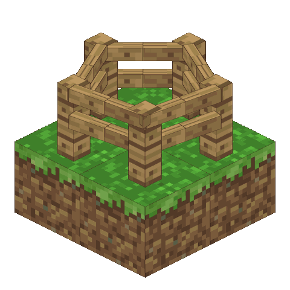
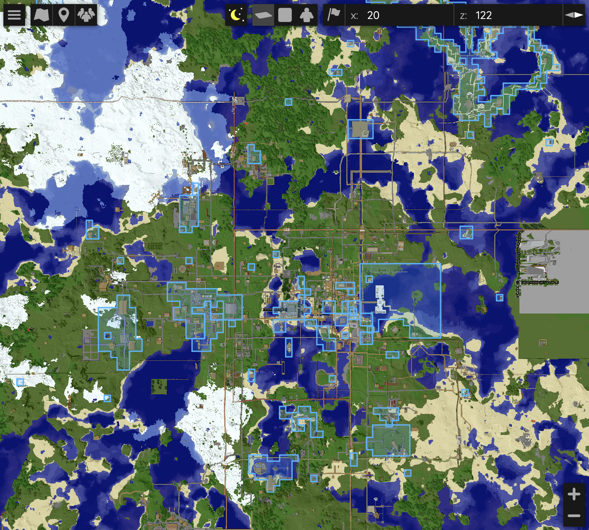
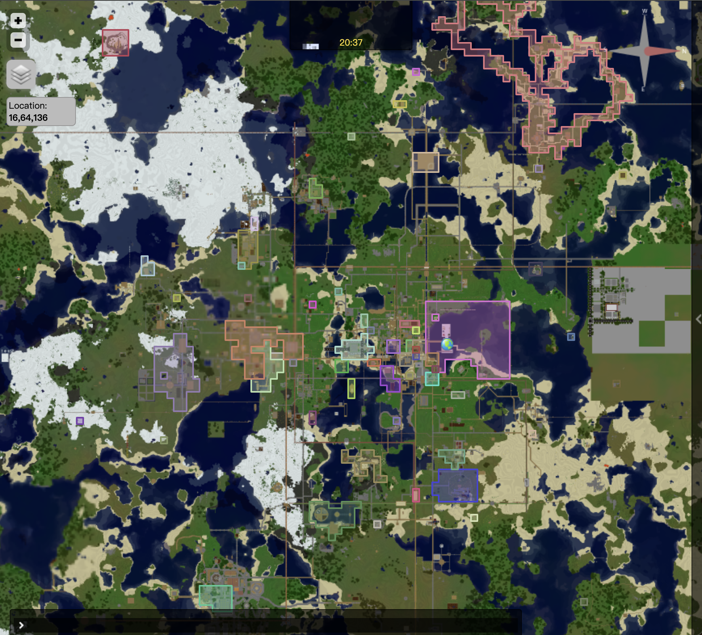
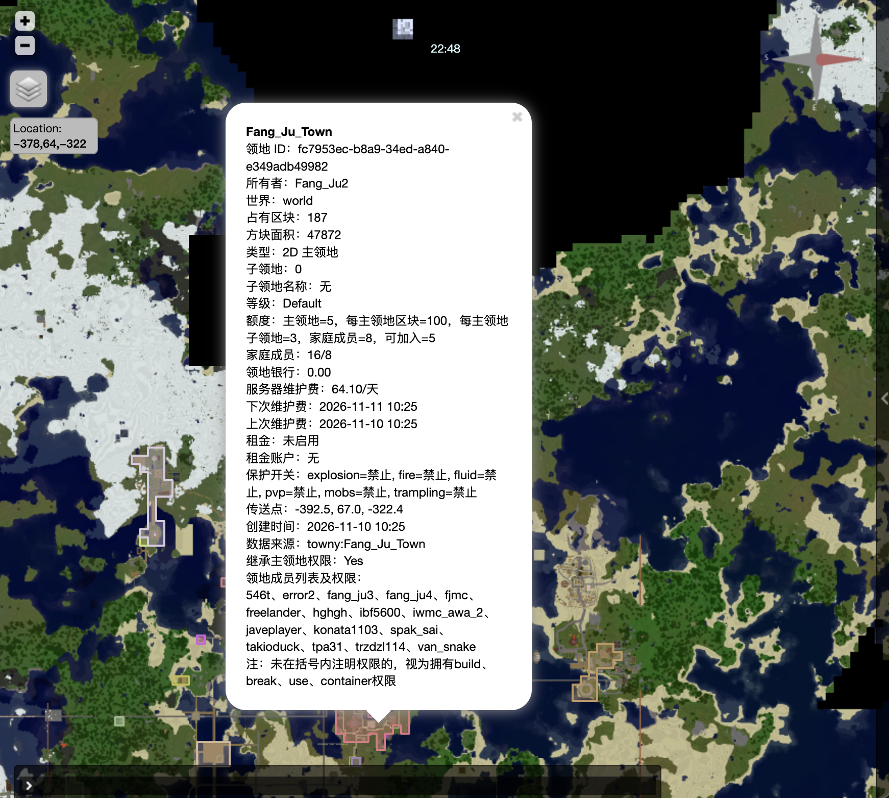

<p align="center">
  
</p>

<h1 align="center">BetaLands</h1>

<p align="center">Land protection for Minecraft Beta 1.7.3 / Project Poseidon</p>

<p align="center">
  
  
  
  
  <a href="https://bstats.org/plugin/bukkit/BetaLands/35249"></a>
</p>

<p align="center"><b>English</b> · <a href="README-zh.md">简体中文</a></p>

BetaLands is a modern land-protection plugin for Minecraft Beta 1.7.3. Main lands use 2D chunk coverage, subclaims use 3D block ranges, land boundaries and details appear on BlueMap and Dynmap, and data can be migrated from Towny.

Player guide: [PlayerWiki.md](PlayerWiki.md)

Other plugins can query land data through Bukkit's `ServicesManager`: [API.md](API.md).

## Feature Gallery

<table>
  <tr>
    <td align="center" width="33%">
      
      <br>
      <sub><b>BlueMap</b>: land boundaries</sub>
    </td>
    <td align="center" width="33%">
      
      <br>
      <sub><b>Dynmap</b>: land boundaries</sub>
    </td>
    <td align="center" width="33%">
      
      <br>
      <sub><b>Land detail card on the web map</b></sub>
    </td>
  </tr>
</table>

## 1 Compatibility and Installation

| Component | Requirement |
| --- | --- |
| Server | [Project-Poseidon](https://github.com/retromcorg/Project-Poseidon) / Minecraft Beta 1.7.3 |
| Java | Java 8 compilation target |
| Economy | [iConomy 5.01](https://www.reddit.com/r/GoldenAgeMinecraft/s/UDZmFBgxf4) |
| Optional | [Towny 0.76](https://bukkit.org/threads/157978/), [Dynmap 0.24](https://dev.bukkit.org/projects/dynmap/files/552350), [BlueMap b173](https://github.com/Moresteck/BlueMap) |

## 2 Player Flow Example

> `AAA` is a main land, `AAA.bb` is a subclaim, and `steve` is a player name.

| Step | Action |
| :--- | :--- |
| 1. Create a main land | Stand in an unclaimed chunk and run `/land create AAA`. The plugin claims the 16×16 block area under your feet and stores your current position as the land spawn. |
| 2. Expand the land | Stand in an adjacent unclaimed chunk and run `/land claim`. Use `/land claim auto` to toggle automatic claiming. While enabled, each new chunk you walk into is claimed automatically. |
| 3. Create a subclaim | If needed, select two corners inside `AAA` with a wooden hoe, or use `/land pos1` and `/land pos2`. Then run `/land subcreate bb`. |
| 4. Add a player | Stand inside the target land and run `/land add steve`. The player receives the default permissions `build`, `break`, `use`, `container`, and `rent`. The target must be online and run `/land accept <land>` to join. |
| 5. Kick or leave | The owner can stand inside the land and run `/land kick steve`. A joined player can run `/land leave` while inside the land. |
| 6. Land teleport | Stand inside the land and run `/land setspawn`. Teleport with `/land spawn` or `/land tp`. |
| 7. Land bank | View: `/land bank info`; deposit: `/land bank deposit 100`; withdraw: `/land bank withdraw 50`. |
| 8. Land rent | Set: `/land rent set 5`; prepay: `/land rent deposit 30`; view: `/land rent info`. |
| 9. Land logs | `/land list`, `/land info`, and `/land logs 100`. |

## 3 Command Reference

### 3.1 Player Commands

| Command | Description | Command | Description |
| --- | --- | --- | --- |
| `/land` / `/land help` | Command help | `/land create <name>` | Create a main land |
| `/land claim [main-land]` | Expand into an adjacent chunk | `/land claim auto [main-land]` | Toggle automatic claiming |
| `/land unclaim [main-land]` | Remove the current chunk without a refund | `/land info [land]` | View land information |
| `/land list [player]` | View a land list | `/land level` | View your level, limits, and rates |
| `/land playtime [player]` | View online-time progress | `/land delete [land]` | Request deletion and show confirmation |
| `/land pos1` / `/land pos2` | Set subclaim corners | `/land subcreate <subclaim-name>` | Create a 3D subclaim |
| `/land flags [land]` | View protection flags | `/land flag <flag> <allow\|deny\|default> [land]` | Change a protection flag |
| `/land add <player> [land]` | Invite a player | `/land kick <player> [land]` | Remove a member |
| `/land accept <land>` | Accept a land invitation | `/land deny <land>` | Decline a land invitation |
| `/land leave [land]` | Leave a land | `/land logs [count] [land]` | View land logs |
| `/land rename <new-name> [land]` | Rename a land | `/land setowner <online-player> [land]` | Transfer main-land ownership |
| `/land perm <player> <permission> <allow\|deny> [land]` | Change a member permission | `/land setspawn [land]` | Set the land spawn |
| `/land spawn [land]` / `/land tp [land]` | Teleport to a land | `/land delete confirm <land>` | Confirm and delete a land |
| `/land bank info [land]` | View the land bank and upkeep | `/land bank deposit <amount> [land]` | Deposit into the land bank |
| `/land bank-all info` | View all owned main-land banks and upkeep | `/land bank-all deposit <amount>` | Deposit into all main-land banks by upkeep share |
| `/land bank withdraw <amount> [land]` | Withdraw from a land bank | `/land rent set <amount> [land]` | Set daily rent |
| `/land rent deposit <amount>` | Prepay into the global rent account | `/land rent withdraw <amount>` | Withdraw from the global rent account |
| `/land rent info [land]` | View rent and prepaid-account information | `/land rent set 0 [land]` | Disable daily rent |

Land names belong at the end of commands. If omitted, BetaLands first uses the current land you are allowed to manage; otherwise it selects your main land only when you own exactly one.

Land deletion takes two steps: run `/land delete [land]`, then run `/land delete confirm <land>`. The confirmation must include the land name. The main-land bank must be exactly `0`. If it is in debt, the plugin shows a `/land bank deposit <amount> [land]` command to clear it. If a prepaid balance remains, the plugin shows a `/land bank withdraw <amount> [land]` command first.

Land deletion is a soft delete. The database retains the land, area, and membership records, sets `is_deleted=1`, records `deleted_at` and `deleted_by`, and changes `name_key` to an archived value that does not reserve the active name. Deleted lands no longer participate in queries, maps, protection, quotas, or name uniqueness, so the same name can be reused.

### 3.2 Administrator Commands

Requires `betalands.admin` or OP:

| Command | Description | Command | Description |
| --- | --- | --- | --- |
| `/land admin` | Show administrator command usage | `/land admin maintenance-exempt <true\|false> [land]` | Set maintenance exemption |
| `/land admin-land <player-command> ...` | Run a player land command as an administrator | `/land admin-land-force <player-command> ...` | Force a command while bypassing selected restrictions |
| `/land admin tp <x> <y> <z>` | Teleport within the current world | `/land admin tp <x> <y> <z> <world>` | Teleport to coordinates in another world |
| `/land admin version` | Show plugin version, JAR name, SHA-256, and Dynmap/BlueMap/iConomy hook state | `/land admin server-bank` | View accumulated server maintenance |
| `/land admin status` | View land, player, economy, and level status | `/land admin refresh-map [dynmap\|bluemap\|all]` | Refresh selected maps immediately |
| `/land admin level [player]` | View a land level for an online or offline player | `/land admin setlevel <player> <level> <days\|permanent>` | Grant a plugin-managed level |
| `/land admin logs [count\|page]` | Query global logs | `/land admin logs land <land> [count\|page]` / `/land admin logs player <player> [count\|page]` | Query by count or `pN` page |
| `/land admin save` | Save the latest state in the background | `/land admin reload` | Reload hot-updatable configuration and levels |

### 3.2.1 Administrator Force Commands

Administrators and OPs can use normal player commands directly on their own lands. For another player's land, use `/land admin-land <player-command> ...`.

For example, `/land admin-land add <player> <land>` adds a member directly while checking family size, the target's joined-land quota, and debt restrictions.

`admin-land` cannot perform `/land accept`, `/land deny`, or `/land leave` on behalf of another player. These personal membership actions must be run by the affected player.

**Behaviors allowed by `/land admin-land-force`:**

- `/land admin-land-force add <player> <land>`:
  Skips land-bank debt checks, family-member limits, and the target player's joined-land quota. The added player remains subject to normal debt-related build protection until the debt is paid.
- `/land admin-land-force create`, `claim`, `claim auto`, `subcreate`:
  Skips level quotas, main-land area and chunk limits, subclaim count and volume limits, and debt checks. No creation or expansion fee is charged.
- `/land admin-land-force kick`, `perm`:
  Kicking and permission changes remain possible while the land is in debt. When `perm` adds `build`, family and joined-land limits are ignored.
- `/land admin-land-force bank withdraw <amount> <land>`:
  Allows withdrawal beyond the current bank balance, leaving the bank negative.
- `/land admin-land-force delete <land>`:
  Skips confirmation and the zero-balance requirement. The previous bank balance is discarded, and the main land and all subclaims are marked deleted.
- `/land admin-land-force spawn`, `tp <land>`:
  Skips maintenance-debt and administrator rent-debt checks.
- `/land admin-land-force setspawn <land>`:
  Does not require the administrator to stand inside the land. The administrator's current position becomes the spawn, but it must be in the same world as the land.

Force commands still enforce data-integrity checks for invalid names, invalid amounts, overlapping lands, selections inside the main land, and existing target worlds. Bypassing those checks would corrupt data or cause runtime errors.

### 3.2.2 Administrator Log Queries

```yaml
/land admin logs [count|pN]
/land admin logs land <land> [count|pN]
/land admin logs player <player> [count|pN]
```

A numeric argument returns the latest N records, with a maximum of 200. `pN` selects a fixed 200-record page: `p1` is the newest page, `p2` contains records 201–400, and so on. Omitting the argument returns the latest 50 records.

### 3.3 Player Permission Nodes

The following nodes are granted to normal players by default. Administrators and OPs automatically pass player action checks:

| Permission Node | Purpose | Default |
| --- | --- | --- |
| `betalands.use` | Use `/land` commands | `true` |
| `betalands.create.main` | Create main lands | `true` |
| `betalands.create.claim` | Expand main lands | `true` |
| `betalands.create.subclaim` | Select and create subclaims | `true` |
| `betalands.teleport` | Teleport to accessible lands | `true` |
| `betalands.member.invite` | Invite players to managed lands | `true` |
| `betalands.member.kick` | Remove members from managed lands | `true` |
| `betalands.member.permission` | Change member permissions | `true` |
| `betalands.land.rename` | Rename managed lands | `true` |
| `betalands.land.setowner` | Transfer managed main lands | `true` |
| `betalands.land.delete` | Request deletion of managed lands | `true` |
| `betalands.land.flags` | Change protection flags | `true` |
| `betalands.land.setspawn` | Set land spawn points | `true` |
| `betalands.land.logs` | Query logs for managed lands | `true` |
| `betalands.bank.use` | Use land banks and batch deposits | `true` |
| `betalands.rent.use` | Configure, prepay, withdraw, or query rent | `true` |

Creation permissions are fully separated into main-land, chunk-expansion, and subclaim nodes. There is no legacy `betalands.create` umbrella node. `betalands.bypass`, `betalands.admin`, and `betalands.admin.force` remain operator-only by default.

## 4 Land Rules and Costs

Land names may contain only ASCII letters, digits, underscores, and hyphens and cannot contain dots. Length is controlled by `limits.min-name-length` and `limits.max-name-length`, defaulting to `2–24`. Active names are globally unique. A soft-deleted name can be reused.

`/land unclaim` removes only one current main-land chunk. A subclaim in the target chunk must be deleted first. A main land must keep at least one chunk. If the saved spawn is in the removed chunk, the explicit spawn is cleared.

A 3D subclaim must be fully inside its main land. Subclaims cannot overlap sibling subclaims in the same horizontal area and overlapping Y range. Two subclaims may share the same X/Z footprint when their Y ranges are completely separate.

### 4.1 Member Permissions

| Permission | Effect |
| --- | --- |
| `build` | Place blocks and empty buckets |
| `break` | Break blocks and fill buckets |
| `use` | Doors, buttons, levers, and similar interactions |
| `container` | Chests, furnaces, dispensers, and similar containers |
| `rent` | Pay daily rent as a member; granted by default |
| `pvp` | Damage players inside the land |
| `manage` | Manage members, permissions, flags, and the spawn |
| `all` | Grant every grantable permission |

Rules:

- Main-land membership applies to the main land and its subclaims. Subclaim membership grants permissions only in that subclaim.
- `/land add` grants `build`, `break`, `use`, `container`, and `rent`. When `protection.allow-pvp-by-default: true`, it also grants `pvp`.
- The owner never pays rent for their own land. Other members pay only when the land has rent enabled and they have effective `rent` permission.
- Only effective `build` permission counts toward the number of lands a player has joined.

### 4.2 Protection Flags

| Flag | Global Default |
| --- | ---: |
| `explosion` | `deny` |
| `fire` | `deny` |
| `fluid` | `deny` |
| `pvp` | `deny` |
| `tp` | `allow` |
| `mobs` | `allow` |
| `trampling` | `allow` |

Effective precedence:

```text
subclaim override > main-land override > global default
```

`tp` controls public teleport. It defaults to `allow`. When disabled, only the owner, members, and administrators may teleport. Actual members cannot teleport while the land has maintenance debt. Non-members may still use public teleport while `tp=allow`.

### 4.3 Level Configuration

File: `plugins/BetaLands/levels.yml`

Default limits:

| Level | Permission | Main Lands | Chunks per Main Land | Subclaims per Main Land | Family Members | Joined Lands | Maintenance Interval |
| --- | --- | ---: | ---: | ---: | ---: | ---: | ---: |
| Default | `betalands.level.default` | 5 | 100 | 3 | 8 | 5 | 3 days |
| VIP | `betalands.level.vip` | 15 | 200 | 10 | 15 | 30 | 3 days |
| SVIP | `betalands.level.svip` | 30 | 300 | 50 | 40 | 100 | 3 days |

Default prices:

| Level | Create Land | Base Expansion | Expansion Increment per Chunk | Subclaim per Block | Upkeep per Chunk/Day | Upkeep per Member/Day |
| --- | ---: | ---: | ---: | ---: | ---: | ---: |
| Default | 300.00 | 20.00 | 5.00 | 0.01 | 0.30 | 0.50 |
| VIP | 250.00 | 20.00 | 4.00 | 0.008 | 0.25 | 0.40 |
| SVIP | 200.00 | 20.00 | 3.00 | 0.005 | 0.20 | 0.30 |

When a player has multiple level permissions, the level with the highest `priority` is used.

The main-land count is checked when creating a land and when `/land setowner` transfers one. A target already at their level limit cannot receive another main land.

`levels.yml` is not limited to these three examples. Add any level IDs under `levels` with `display-name`, `permission`, `priority`, limits, prices, and maintenance rates. `default-level` selects the level used when no configured permission matches.

### 4.4 Persistent Timed Levels

The player table stores the player's level, whether it is managed by BetaLands, and its expiration time. A managed level takes priority over Bukkit level permissions and reverts to Default after expiration, even while the player is offline.

```yaml
/land admin setlevel Steve vip 30          # VIP for 30 days
/land admin setlevel Steve svip permanent # Permanent SVIP
```

### 4.5 Land Maintenance

Maintenance flow:

```text
server rates per chunk/member
→ owner deposits into the main-land bank
→ the land bank is charged at the configured level interval
→ successfully collected amounts accumulate in BetaLands' internal server-maintenance bank
```

The bank balance represents both prepaid maintenance and debt:

```yaml
/land bank info [land]             # View maintenance information
/land bank deposit <amount> [land] # Deposit maintenance prepayment
/land bank withdraw <amount> [land]# Withdraw unused prepaid funds
```

A positive balance is prepaid maintenance; a negative balance is debt. Deposits clear debt first and leave the remainder as prepaid maintenance.

Owners can use `/land bank-all info` to view every owned main-land bank and `/land bank-all deposit <amount>` to debit the personal iConomy account once and distribute the amount by each land's current daily upkeep share. Allocation is exact to `0.01`, and the sum equals the actual debit. Lands with zero upkeep have zero weight. If all owned lands have zero chargeable upkeep, the batch deposit is rejected. Batch withdrawal is not provided; use `/land bank withdraw` per land.

When `/land admin maintenance-exempt true [land]` exempts a main land with a negative bank balance, the negative balance is cleared. Disabling the exemption later does not restore the previous debt.

Money precision is controlled by:

```yaml
economy:
  max-decimal-places: 2
```

Valid values are `0`, `1`, and `2`. The limit applies to every amount argument accepted by `/land bank`, `/land bank-all`, and `/land rent`. Excess decimal places are rejected rather than rounded. Input length and numeric format are checked before parsing.

Changing `storage.*`, MySQL connection settings, or `save-interval-seconds` requires a server restart. `/land admin reload` does not rebuild storage or reschedule asynchronous saves.

### 4.6 Land Rent

The main-land owner can set daily rent on a main land or subclaim. Rent is charged only to members with effective `rent` permission in that specific land. The owner never pays rent. Setting a member's `rent` permission to `deny` removes them from rent charges and reminders for that land.

```yaml
/land rent set <amount> [land]         # Set member rent
/land rent set 0 [land]                # Disable rent
/land rent deposit <amount>            # Deposit into the global rent account; no land argument
/land rent withdraw <amount>           # Withdraw from the global rent account; no land argument
/land rent info [land]                 # View rent information
```

Each player has one server-wide rent account regardless of how many rented lands they belong to. All rent charges use that account.

`/land rent deposit <amount>` operates only on the global account and does not accept a land name. The player must have at least one active rent obligation or unpaid rent. The amount then enters the global account directly. It is not distributed by land and does not require the player to stand inside a land.

`/land rent withdraw <amount>` also operates only on the global account and does not accept a land name. `/land rent set` and `/land rent info` still accept a land because they configure or inspect a specific land.

When multiple lands charge together, charges are processed from lowest daily rent to highest:

```text
Enough balance: all due rent is charged.
Not enough balance: lower-rent lands are paid first until the account becomes negative.
The land that causes the negative balance receives the debt.
A later deposit pays that debt first and transfers the covered amount to the corresponding land owner.
The remainder stays as global prepaid rent.
```

### 4.7 Debt Restrictions

If the prepaid balance is below seven days of future charges but remains non-negative, BetaLands only sends a reminder and does not block actions.

| Area | Main-Land Bank Debt | Rent Account Debt |
| --- | --- | --- |
| Blocked actions | Expanding, creating subclaims, adding or removing members, adding `build` through `/land perm`, land teleport, and protected building, breaking, buckets, doors, buttons, containers, and similar interactions. Withdrawals are blocked. Maintenance continues to accrue and the negative balance can grow. | Withdrawing. Protected building, breaking, buckets, doors, buttons, containers, and similar interactions in the debt land. Teleporting to the debt land. If the debt belongs to a main land, its subclaims are also restricted. Rent charges pause while the account is negative; skipped later charges are not collected retroactively. |
| Allowed actions | `/land unclaim`, voluntarily leaving, viewing logs, and `/land bank deposit`. Debt must be cleared and deletion confirmed before deletion. Debt never auto-deletes a land or removes members. Deposits clear debt first and then become prepaid upkeep. | `/land rent deposit` and `/land rent info`. Other lands without debt are unrestricted. Rent debt alone does not block member changes or expansion, though main-land bank debt may. Deposits pay the debt owner first and leave the remainder as global prepaid rent. |

### 4.8 Fee Reminders

- After joining, a player receives a summary of maintenance for owned main lands and rent they owe as a rent-paying member.
- If an owned main-land bank covers fewer than seven days of upkeep, or a member's prepaid rent covers fewer than seven days, affected online players are reminded once per minute.
- Outstanding debt uses the debt reminder. Lands without upkeep or rent do not generate duplicate warnings.

Reminders inspect the land bank and rent account, not the player's personal iConomy total.

Message templates are under `fees` in `plugins/BetaLands/lang/game.yml`.

### 4.9 Territory Messages

Entering or leaving a main land or subclaim displays the land name and owner. Main lands display as `AAA`; subclaims display as `AAA.bbb`. Entering wilderness displays `Wilderness`.

```yaml
territory-messages:
  enabled: true
  show-wilderness: true
```

Templates are under `territory` in `plugins/BetaLands/lang/game.yml`.

## 5 Map Markers

- Dynmap uses two separate marker sets for main lands and subclaims. Irregular lands are drawn as connected outlines with separate inner holes.
- BlueMap shows connected land outlines, holes, and subclaim Y ranges.
- Land details list each member's effective permissions. The default `build`, `break`, `use`, `container`, and `rent` set is not repeated for every member; additional or different permissions appear in parentheses.
- Protection flags show only allow or deny, without inheritance-source labels.
- Map details also show land ID, world, chunks, area, type, subclaim count, level limits, family size, bank balance, maintenance/rent timing, spawn, creation time, source, and parent-permission inheritance.
- BlueMap refreshes after land changes. Dynmap refreshes daily and injects markers about five seconds after startup. Administrators can refresh immediately:

```text
/land admin refresh-map
/land admin refresh-map dynmap
/land admin refresh-map bluemap
```

Disable the startup Dynmap injection with:

```yaml
maps:
  dynmap:
    startup-refresh: false
```

When disabled, no markers are injected at startup, but the daily refresh remains enabled and `/land admin refresh-map dynmap` still works.

BlueMap and Dynmap use independent schedules. BlueMap waits 15 seconds after land changes by default. Dynmap refreshes daily at server-local `01:00`:

```yaml
maps:
  dynmap:
    enabled: true
    daily-refresh-hour: 1
    daily-refresh-minute: 0
  bluemap:
    enabled: true
    refresh-delay-seconds: 15
```

Both integrations are enabled by default.

BlueMap updates markers per land. For Dynmap 0.24 compatibility, each Dynmap refresh deletes and rebuilds the persistent `betalands` marker sets. Outlines are built from thin rectangular edge markers.

### 5.1 Map Colors, Language, and Display

Colors are configured separately in `config.yml`. Use a quoted `#RRGGBB` value or `auto`:

```yaml
maps:
  colors:
    dynmap:
      main: auto
      subclaim: auto
    bluemap:
      main: auto
      subclaim: auto
```

Dynmap `auto` derives colors from the land owner. BlueMap `auto` uses blue main lands and orange subclaims. Run `/land admin reload` after changing colors.

Marker-set names and detail text are in `BetaLands/lang/map-zh.yml` and `map-en.yml`, selected through `language.map` in `config.yml`.

Dynmap is top-down. Subclaim markers can include Y-range data but cannot display the 3D extruded volumes used by BlueMap.

### 5.2 Map Layers and Player Lists

Dynmap `plugins/dynmap/configuration.txt` must retain both components:

```yaml
components:
  - class: org.dynmap.MarkersComponent
    type: markers

  - class: org.dynmap.ClientComponent
    type: playermarkers
    showplayerfaces: true
    hidebydefault: false
    label: "Players"
```

The first component provides the Marker API required for land markers. The second provides the online-player layer. If `/dynmap hide` was used, run `/dynmap show`. With `display-whitelist: true`, `hiddenplayers.txt` acts as a whitelist.

Enable these options in BlueMap `plugins/BlueMap/plugin.conf`:

```yaml
live-player-markers: true
hidden-game-modes: ["spectator"]
hide-vanished: true
hide-invisible: true
```

BlueMap's built-in web server requires `webserver.conf` with `enabled: true` and the correct port, default `8100`. If the website is served externally, configure `write-players-interval` so `live/players.json` is written regularly. Dynmap's default web port is `8123`.

Restart the map plugin or server after changing map configuration and verify that the `Players` layer is not hidden. Only online players appear; BlueMap can hide spectators, vanished players, and invisible players according to the options above.

### 5.3 Dynmap Area-Marker Residue After World Changes

Dynmap 0.24 does not clear old area markers when changing worlds, so main-world lands can remain visible in other dimensions. BetaLands marker world data is correct; the residue is a Dynmap frontend issue.

In `plugins/dynmap/web/js/markers.js`, find `removeAllMarkers()` and add this after `set.markers = {};`:

```javascript
$.each(set.areas, function(aname, area) {
    set.layergroup.removeLayer(area.our_area);
});
set.areas = {};
```

Clear the browser cache and force-refresh the map. Dynmap 0.25+ frontend resources may also work, but verify server compatibility.

### 5.4 Dynmap Refresh Thread Limitation (Known Issue)

Dynmap 0.24 marker refreshes currently run on the Bukkit main thread and can cause lag. An asynchronous build/delta-marker approach similar to BlueMap was tested, but Dynmap did not render markers reliably. Dynmap therefore refreshes daily at `01:00` by default to reduce the effect on peak hours.

## 6 Administration and Maintenance

### 6.1 Data Migration

Towny is the only supported migration source:

```yaml
/land admin migrate-towny
/land admin migrate-towny /path/to/plugins/Towny
```

BetaLands data is saved and backed up before migration. Towny file reading, town-block conversion, name conflict handling, and subclaim generation run serially in the background. The final merge and map refresh return to the server main thread. Reading live loaded Towny objects must start on the main thread; conversion after that capture still runs asynchronously.

Towny towns become main lands. Resident plots can become 3D subclaims. PVP, fire, explosion, mob, and trampling settings are migrated. Start, backup, conversion, application, and completion are written to the console. Results are applied to the active data immediately; saving and map refresh are queued afterward without requiring a plugin reload.

Towny `isPublic` is not imported because BetaLands has no public-join gameplay. Migrated main lands are saved as non-public. Town names preserve case; unsupported characters become hyphens. The converted name is used unless it conflicts with an existing or another migrated name. A conflict adds `towny-`, followed by `-2`, `-3`, and so on. Conflicts ignore case. Re-importing an existing Towny land does not treat its previous name as a conflict.

### 6.2 Database Logs

Log database:

```yaml
plugins/BetaLands/logs.db
```

- `land_logs`: land, member, permission, flag, spawn, and rent actions.
- `economy_logs`: creation fees, expansion fees, bank transfers, rent, and maintenance.

Writes are asynchronous, and queries do not block the server main thread. Shutdown waits for queued writes before disabling the logger.

Administrator, console, and SYSTEM actions are marked with `admin_action`. Normal `/land logs` queries hide those records by default; `/land admin logs` always includes them. Configure this with `logs.hide-admin-actions-from-players`.

Log retention is configured in days:

```yaml
logs:
  retention-days: 0
```

`0` keeps logs permanently. A value of `10` checks immediately at startup and then deletes `land_logs` and `economy_logs` records older than ten days once per day. `/land admin reload` updates the retention period without a restart.

### 6.3 Messages and Language

In-game messages are English-only and live in `lang/game.yml`. They support `&` color codes and placeholders such as `{player}` and `{land}`.

| Console Messages | Map Marker Messages |
| --- | --- |
| Files: `lang/console-zh.yml`, `lang/console-en.yml` | Files: `lang/map-zh.yml`, `lang/map-en.yml` |
| Setting: `language.console: auto` | Setting: `language.map: auto` |
| Values: `auto`, `zh`, `en` | Values: `auto`, `zh`, `en` |
| Used for hooks, refreshes, errors, and other background output | Used for Dynmap/BlueMap layer names and land details |

Run `/land admin reload` after editing. `auto` follows the server JVM language. In-game messages always use English `game.yml`.

In-game messages follow these color rules:

| Content | Color |
| --- | --- |
| `[BetaLands]` prefix | Yellow `&e` |
| Normal body text | White `&f` |
| Player, land, world, source, and permission names | Blue `&b` |
| Amounts, counts, limits, and coordinates | Green `&a` |
| Time, duration, and reminders | Yellow `&e` |
| Failure reasons and errors | Red `&c` |

Templates support `&0` through `&f` and `&k` through `&r`. Placeholder values receive the emphasis colors above, then the template color is restored. Custom body colors and standardized placeholder colors can be used together.

### 6.4 Main Configuration, Permissions, and Storage

| Configuration Group | Purpose |
| --- | --- |
| `protection.outside-build-hours` | Accumulated online hours required to build outside lands |
| `protection.op-bypass` | Whether OPs bypass protection automatically; `betalands.bypass` grants bypass separately |
| `protection.public-teleport` | Global default for the `tp` flag, default `true`; controls non-member public teleport |
| `protection.allow-land-flag-editing` | Whether owners and managers may edit protection flags |
| `limits.*` | Land area, subclaim volume, and name-length limits |
| `maps.dynmap.enabled` / `maps.bluemap.enabled` | Enable Dynmap and BlueMap independently; both default to `true` |
| `maps.dynmap.startup-refresh` | Inject Dynmap markers once after startup; default `true` |
| `maps.show-subclaims` | Show subclaims on maps; currently affects BlueMap only |
| `maps.dynmap.*` / `maps.bluemap.*` | Dynmap daily refresh time and BlueMap post-change delay |
| `economy.*` | Economy enablement, administrator charging, maintenance exemption, and default rent |

Additional settings:

| Configuration Key | Purpose |
| --- | --- |
| `towny.import-resident-plots-as-subclaims` | Convert Towny resident plots to 3D subclaims |
| `economy.require-economy` | Require a working iConomy; when `false`, missing economy runs in free mode |
| `economy.charge-admins` | Charge administrators and OPs for charged land operations |
| `economy.admin-created-maintenance-exempt` | Exempt admin- or OP-created main lands from maintenance by default |
| `economy.default-main-rent` | Initial main-land daily rent; enable it with `/land rent set` |
| `economy.default-subclaim-rent` | Initial subclaim daily rent; enable it with `/land rent set` |
| `default-level` (`levels.yml`) | Level ID used when no configured level permission matches |
| `logs.hide-admin-actions-from-players` | Hide admin, console, and SYSTEM actions from player log queries; default `true` |
| `logs.retention-days` | Delete logs older than this many days; `0` keeps them forever |
| `bstats.enabled` | Send anonymous bStats usage data; default `true`, with a global opt-out in `plugins/bStats/config.yml` |

SQLite and MySQL use schema v3. Money is stored as integer cents, rent accounts are unique per player, lands support soft deletion, and areas, members, and subclaims use foreign keys. The plugin does not automatically migrate older database schemas. Back up and explicitly migrate an existing database before upgrading. The TSV backend continues to use complete file replacement.

## 7 Sponsorship and Support

If this project is useful to you, you can support development through Ko-fi or Afdian. Sponsors can receive help with installation, configuration, and troubleshooting.

<p align="center">
  <a href='https://ko-fi.com/J5C529ZWWL' target='_blank'></a>
  <a href='https://afdian.com/a/sss000' target='_blank'></a>

<br><br><br>

<p align="center">
  
</p>
